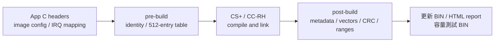

[知識庫首頁](https://released.github.io/) · [RH850 Bootloader](index.html)

<a id="article_top"></a>

# App Metadata、IRQ 與更新耗時

C header 編輯、512-entry IRQ table、建置產物及 CAN FD 實測時間。

<!-- RH850_APP_CHAPTER_BEGIN -->
<a id="rh850-app-editing"></a>

### Metadata：輸入、產生與驗證

| 分類 | 修改位置 | 產生／使用位置 |
| --- | --- | --- |
| App 發行 | `app_image_config.h`：version、build、target、role、update transports、version control | pre-build → `generated_projection/app_identity.h` |
| MCU／Flash／格式 | 各工程的 `image_metadata_config.h` | Boot／App 各自編譯 `image_metadata_profile.c` |
| CAN 模式／速率／ID | 各工程的 `can_boot_config.h` 與 `hal/can/can_config.c` | 實際 register timing 與 metadata masks 需一致 |
| IRQ | App 的 `app_irq_handlers.h` | pre-build → `generated_projection/device_vectors.c` |
| 建置結果 | 實際 `.mot`／`.map` | post-build → image size、尾端 CRC32、更新 BIN、HTML report |
| 裝置驗證 | `hal/image/image_metadata.c/.h`、`device_image.c/.h` | 獨立 C90 解析、profile、範圍、CRC 與向量檢查 |

更換 MCU 時，將 Flash geometry、FCL支援、clock／pins、ECC／RAM、exception／EIINT來源及 metadata profile 作為一組工程配置核對。
App 發行 identity、IRQ header、建置生成及實際映像驗證的流程保持一致。
Boot／App 的版本各自獨立；App minimum Boot 取自配對的 Boot contract，不要求 App version 等於 Boot version。

欄位的逐 byte 定義見 [metadata byte reference](reference.html#rh850-metadata-bytes)。
該表的欄位 offset 可共用；實際絕對位址以本節 mapping 換算。
例如 metadata `0x74..0x77` 在本工程為 `0x10174..0x10177`，保存 App version control 的 LE32 值。

本 profile 的 target 是 `0x8501`，IRQ ABI 是 `0x31563852`（R8V1）。
`APP_IMAGE_VERSION_CONTROL=0` 是預設；目前有效 App 設為1時，普通 START 接受同版／新版，拒絕較舊版本。
維護降版操作仍經過 identity、layout、CRC、IRQ 與 minimum Boot 檢查，操作見 [版本政策](https://released.github.io/slide_isp_tool_for_RL78/#force-old-version)。
沒有有效 App 時，不保留獨立的版本下限。

### IRQ 編輯與 Boot／App 交接

`app_irq_handlers.h` 的數字是 **EIINT channel index**。
來源是本 MCU 的 SC `r_cg_intvector.c` 及硬體手冊 interrupt table；不是 Flash byte address。
例如 channel23 的 App table entry address 是 `0x10400 + 23 × 4 = 0x1045C`。

```c
/* App-local normal EIINT handlers; generated table contains all512 entries. */
#define APP_IRQ_HANDLERS(X) \
    X(23U, Device_CanRxIsr) \
    X(84U, r_Config_OSTM0_interrupt)

#pragma interrupt app_aux_irq(enable=false, fpu=true, callt=false)
void app_aux_irq(void) { /* Acknowledge source; queue bounded work. */ }
```

新增 IRQ 時，先用 SC 設定所需周邊、pin、clock 與 IRQ，再將其 global ISR 登錄於 App header。
App ISR 不使用 `channel=`；產生器負責 table mapping。
若採用 SC 的 OSTM ISR，建置使用保留原始 SC 的 no-channel projection。
CS+ 的固定 linker layout 不需隨 IRQ 數量增加而調整；有新增 `.c` 時仍需加入該 App 的 source registration。

Boot 與 App 分別連結完整512-entry table，未使用項目共用預設 handler。
Boot 保留 reset 入口；交接時遮罩 IRQ、停止 Boot 周邊、設定 owner=`0x55`、App EBASE／INTBP 及 PSW.EBV，再進入 App startup。
Boot owner 為 `0xAA`。
各映像可以使用相同 ISR 函式名稱；同一映像內的重複定義由 linker 拒絕。
EIINT handler 使用 EIRET；exception table 另行處理。


#### App 修改與建置步驟

1. 在 App 工程的 `app_image_config.h` 編輯 version／build。target、role、transports 與 version control 的用途由 header 註解說明；MCU／Flash／介面契約有變動時，同步核對搭配的 Boot。
2. 在 SC 與本 MCU 的 `r_cg_intvector.c`／硬體手冊查出周邊的 EIINT channel index，再編輯 `app_irq_handlers.h`。目前 CAN RX 使用23，OSTM0 使用84；這些數字是中斷索引。
3. ISR 使用 global、非 static 的 EIRET handler，不加 `channel=`。周邊資料讀取、旗標清除與中斷允許依所選 SC driver 的實際來源處理；ISR 只留下有界資料或事件，前景工作放在 `custom_func.c`。
4. 新增 `.c` 時，將檔案加入該 App 的 CS+ source registration。既定 linker／512-entry table 可容納新增 mapping，不因 IRQ 數量由4增至10而另外調整 table 容量。
5. 在 App 根目錄執行 `powershell -NoProfile -ExecutionPolicy Bypass -File .\build.ps1`，或 CS+ Rebuild。pre-build 產生 identity／vector；post-build 驗證實際映像後產生更新 BIN。
6. 開啟 `DefaultBuild/app_build_report.html`，核對版本、Metadata、CRC、全部512個 IRQ entries 與目的地。`test_bins/auto/index.html` 提供由同一份 App 產生的容量測試 BIN；實板更新另以 Tool 的 Firmware update report 記錄結果。

App-only 建置使用本工程來源與設定，不需要 Boot checkout。搭配安裝的兩份映像仍使用相容的 Flash／IRQ／格式契約。



<a id="rh850-irq-entry"></a>

#### IRQ 入口與交接成本

CAN RX／OSTM0 的 TB 設為 table reference，App EIINT 不逐次回 Boot 讀 owner；`Device_JumpAsm()` 僅在交接時切換 EBASE／INTBP。
App EIINT 路徑為 CPU → App INTBP entry → App ISR → EIRET。硬體中斷接受、table 存取及 ISR 前言／結尾仍有成本，依 CPU／memory wait 配置量測；可用 GPIO pulse 分別觀察 IRQ 進入與 ISR 執行時間。
設定依據為 [Renesas RH850 初始化說明](https://tool-support.renesas.com/autoupdate/support/onlinehelp/csp/V8.14.00/CS%2B.chm/Compiler-CCRH.chm/Output/ccrh08c0201y.html)。

<a id="rh850-build-products"></a>

### 建置與使用產物

需要現有 CS+ CC／CC-RH 與 Windows PowerShell，不需要 Python 作為 firmware 建置環境。
在所選 Boot、App 或 Transfer 工程的根目錄執行：

```powershell
powershell -NoProfile -ExecutionPolicy Bypass -File .\build.ps1
```

Classical CAN 與 CAN FD 各工程使用相同的本機建置方式。
App 來源、設定與工具均包含在 App 工程中，建置不需要另一份 Boot checkout，也不重建 Boot。
CS+ Rebuild 使用相同的 pre／post 檢查；SC 重新產生後，核對工程設定再執行 Rebuild。

| 產物（各工程 `DefaultBuild`） | 用途 |
| --- | --- |
| Boot `boot0000_FFFF.hex` | 燒錄器安裝64 KiB Boot，範圍不含 App |
| App `<AppProject>_update.bin` | Tool 的 CAN Upgrade 載入檔；包含 entry、metadata、vectors、code及尾端CRC |
| App `flash_app_variable_CRC.hex` | 燒錄器直接安裝 App，帶絕對位址，範圍不含 Boot |
| App `app_build_report.html` | 瀏覽器閱讀實際 BIN 的 size／CRC／SHA256、256-byte metadata與512個IRQ entries |
| Transfer `<TransferProject>.mot` | 從零位址執行的獨立通訊測試，使用燒錄器安裝 |
| 原始 linker `.mot`／`.abs`／`.map`／`.asm` | 工程診斷及封裝檢查；App 原始 MOT 尚未封裝 image size／尾端CRC，不作更新輸入 |

更新操作與報告見 [Tool 操作入口](tool-guides.html)。
完成後可對照 App 確認與獨立 UART 的 image tag、`log(timer)-V1` 遞增 counter。
<!-- RH850_APP_CHAPTER_END -->

<!-- RH850_TIMING_BEGIN -->
<a id="rh850-update-timing"></a>

## CAN FD App BIN 大小與更新耗時

下表採用 Firmware update report 的實際紀錄，作為估算更新時間的參考。
映像大小使用 `input_bytes`；總耗時使用 `elapsed_ms`，包含 Metadata、START、傳送、END CRC、App 啟動確認與 Tool 流程開銷。
同大小及相同映像／通訊條件採首次完成 CRC／App 確認的紀錄；其餘測次保留在來源摘要。
App BIN 包含 entry、Metadata、IRQ table、程式、填充與 CRC；64 KiB Boot 不在更新 BIN 內，此 EVM 的 App 容量為960 KiB。

<!-- RH850_TIMING_DATA_BEGIN -->
| App BIN | bytes | 寫入相關階段 | App 確認 | 總耗時 | 報告 |
| --- | --- | --- | --- | --- | --- |
| 29.18 KiB | 29,876 | 16.2 s | 10.1 s | 26.8 s | [量測摘要](data/update_20261027_070530_320_31112_4626953_1.html) |
| 64.00 KiB | 65,536 | 34.3 s | 9.8 s | 44.6 s | [量測摘要](data/update_20261027_070726_000_31112_4742640_2.html) |
| 192.00 KiB | 196,608 | 100.4 s | 10.4 s | 111.4 s | [量測摘要](data/update_20261027_070952_777_31112_4889406_3.html) |
| 448.00 KiB | 458,752 | 233.9 s | 10.3 s | 244.7 s | [量測摘要](data/update_20261027_071505_750_31112_5202390_4.html) |
| 960.00 KiB | 983,040 | 499.5 s | 11.8 s | 511.8 s | [量測摘要](data/update_20261027_072426_940_31112_5763562_5.html) |

Host Baud：115200 bit/s；報告記錄的 bus 條件：CAN FD 500K/2M, standard data RX filter 0x00000701 / 0x000007FF。
寫入相關階段為 Metadata＋START＋transfer＋END CRC；總耗時另外包含 App 確認及未單獨分階段的 Tool 開銷。

### 分階段原始數值

| 來源報告 | Metadata | START | transfer | END CRC | App 確認 | elapsed_ms |
| --- | --- | --- | --- | --- | --- | --- |
| 20261027_070530_320_31112_4626953_1 | 1055 ms | 15 ms | 15077 ms | 32 ms | 10099 ms | 26795 ms |
| 20261027_070726_000_31112_4742640_2 | 1055 ms | 32 ms | 33151 ms | 64 ms | 9761 ms | 44578 ms |
| 20261027_070952_777_31112_4889406_3 | 1067 ms | 64 ms | 99113 ms | 160 ms | 10441 ms | 111366 ms |
| 20261027_071505_750_31112_5202390_4 | 1059 ms | 160 ms | 232331 ms | 336 ms | 10305 ms | 244718 ms |
| 20261027_072426_940_31112_5763562_5 | 1086 ms | 336 ms | 497394 ms | 689 ms | 11751 ms | 511840 ms |
<!-- RH850_TIMING_DATA_END -->

CAN FD 使用 nominal 500 kbit/s／data 2 Mbit/s；對應範例的資料幀使用 BRS。
PC 到 MCU host 的 Host Baud 與 CAN bus 速率分別記錄，不將 data rate 當成實際有效寫入速率。
耗時供相同 Host Baud／CAN 設定下的量級參考。

容量與 Boot 分區見 [Flash mapping](porting.html#rh850-flash-layout)，封包與 page 累積見 [格式參考](reference.html#rh850-can-frames)，App IRQ／交接見 [App 開發](app-development.html#rh850-app-editing)。
操作後的實際結果以 [Firmware update report](https://released.github.io/slide_isp_tool_for_RL78/status-and-reports.html#update-confirmation) 為準。
<!-- RH850_TIMING_END -->

---

[上一主題：Classical CAN／CAN FD device 工程](can-device.html) · [指南入口](index.html) · [下一主題：UART／Xmodem／I2C device 工程](serial-device.html)
