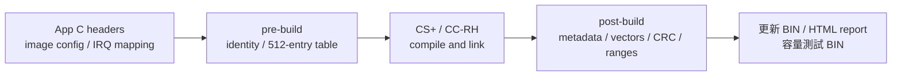

[知識庫首頁](https://released.github.io/) · [RH850 Bootloader](index.html)

<a id="article_top"></a>

# App Metadata、IRQ 與更新耗時

C header 編輯、512-entry IRQ table、建置產物及 CAN FD 實測時間。

<!-- BOOTLOADER_TOPICS_BEGIN -->
## 本頁主題

| 章節／規格 | 本頁 | 另一平台 |
| --- | --- | --- |
| A. 專案配置與共用介面 | [閱讀](#guide-app-development-1) | [RL78](../slide_boot_loader_for_RL78/app-development.html#guide-app-development-1) |
| B. Metadata 設定與產生來源 | [閱讀](#guide-app-development-2) | [RL78](../slide_boot_loader_for_RL78/app-development.html#guide-app-development-2) |
| C. App Vector Table：新增 IRQ 範例 | [閱讀](#guide-app-development-3) | [RL78](../slide_boot_loader_for_RL78/app-development.html#guide-app-development-3) |
| D. 產生與建置 | [閱讀](#guide-app-development-4) | [RL78](../slide_boot_loader_for_RL78/app-development.html#guide-app-development-4) |
| E. BIN 與向量驗證 | [閱讀](#guide-app-development-5) | [RL78](../slide_boot_loader_for_RL78/app-development.html#guide-app-development-5) |
| F. 常見錯誤與只換 App 的邊界 | [閱讀](#guide-app-development-6) | [RL78](../slide_boot_loader_for_RL78/app-development.html#guide-app-development-6) |
| G. Device CAN 速率：250K／500K／1M | [閱讀](#guide-app-development-7) | [RL78](../slide_boot_loader_for_RL78/app-development.html#guide-app-development-7) |
| App BIN 更新耗時參考 | [閱讀](#guide-app-development-8) | [RL78](../slide_boot_loader_for_RL78/app-development.html#guide-app-development-8) |
<!-- BOOTLOADER_TOPICS_END -->

<!-- RH850_APP_CHAPTER_BEGIN -->
<a id="rh850-app-editing"></a>

## Device 開發實作：編輯 Metadata、增加 IRQ、產生並驗證 App

<a id="guide-app-development-1"></a>

### A. 專案配置與共用介面

#### Metadata：輸入、產生與驗證

| 分類 | 修改位置 | 產生／使用位置 |
| --- | --- | --- |
| App 發行 | `app_image_config.h`：version、build、target、role、update transports、version control | pre-build → `generated_projection/app_identity.h` |
| MCU／Flash／格式 | 各工程的 `image_metadata_config.h` | Boot／App 各自編譯 `image_metadata_profile.c` |
| CAN 模式／速率／ID | 各工程的 `can_boot_config.h` 與 `hal/can/can_config.c` | 實際 register timing 與 metadata masks 需一致 |
| IRQ | App 的 `app_irq_handlers.h` | pre-build → `generated_projection/device_vectors.c` |
| 建置結果 | 實際 `.mot`／`.map` | post-build → image size、尾端 CRC32、更新 BIN、HTML report |
| 裝置驗證 | `hal/image/image_metadata.c/.h`、`device_image.c/.h` | 獨立 C90 解析、profile、範圍、CRC 與向量檢查 |

更換 MCU 時，將 Flash geometry、FCL支援、clock／pins、ECC／RAM、exception／EIINT來源及 metadata profile 作為一組工程配置核對。
App 發行 identity、IRQ header、建置生成及實際映像驗證的流程保持一致。
Boot／App 的版本各自獨立；App minimum Boot 取自配對的 Boot contract，不要求 App version 等於 Boot version。

欄位的逐 byte 定義見 [metadata byte reference](reference.html#rh850-metadata-bytes)。
該表的欄位 offset 可共用；實際絕對位址以本節 mapping 換算。
例如 metadata `0x74..0x77` 在本工程為 `0x10174..0x10177`，保存 App version control 的 LE32 值。

本 profile 的 target 是 `0x8501`，IRQ ABI 是 `0x31563852`（R8V1）。
`APP_IMAGE_VERSION_CONTROL=0` 是預設；目前有效 App 設為1時，普通 START 接受同版／新版，拒絕較舊版本。
維護降版操作仍經過 identity、layout、CRC、IRQ 與 minimum Boot 檢查，操作見 [版本政策](https://released.github.io/slide_simple_renesas_isp_tool/#force-old-version)。
沒有有效 App 時，不保留獨立的版本下限。


#### A1. 設定檔與產物分工

| 檔案 | 使用者修改的內容 | 建置結果／使用者核對 |
| --- | --- | --- |
| `app_image_config.h` | App version、build、target、role、transport、version control | `generated_projection/app_identity.h`、實際 BIN 的 Metadata |
| `app_irq_handlers.h` | EIINT index 與 global ISR symbol | `generated_projection/device_vectors.c`、完整512-entry table |
| `image_metadata_config.h` | MCU、Flash、Boot reserve、IRQ ABI、最低 Boot 契約 | Boot／App 各自的 profile 與 linker／封裝檢查 |
| `can_boot_config.h` | CAN mode、IDs、編譯速率宣告 | Boot／App INFO、Metadata 與 driver timing 一致 |
| `boot_app_handoff.h` | RAM cookie、signature／request／owner | startup 與交接 API 使用相同定義 |
| `DefaultBuild/*_update.bin` | 由封裝器產生 | 使用 Tool 載入；不手動修改 bytes |

<a id="guide-app-development-2"></a>

### B. Metadata 設定與產生來源

#### 編輯 app_image_config.h

在所選 Classical CAN 或 CAN FD App 根目錄編輯這六項發行設定。
本表以 CAN App 為例；UART／Xmodem／I2C 的允許介面由各自工程配置。

| Define | 範例 | 用途與修改條件 |
| --- | --- | --- |
| `APP_IMAGE_VERSION` | `0x00010203UL` | 1.2.3；三個 byte 分別是 major／minor／patch，不是十進位日期 |
| `APP_IMAGE_BUILD` | `20261027UL` | build 識別，獨立於版本排序；可採 YYYYMMDD 慣例 |
| `APP_IMAGE_TARGET_ID` | `0x8501U` | 此 EVM 工程契約；只改成其他 target 不會完成移植，profile 不符會被拒絕 |
| `APP_IMAGE_ROLE` | `1U` | DEVICE_APP；例如5不是此 App 的有效角色，產生／驗證會停止 |
| `APP_IMAGE_UPDATE_TRANSPORTS` | `0x01U` | CAN=01、I2C=02、UART=04；CAN 工程必須符合其 Boot 的更新介面 |
| `APP_IMAGE_VERSION_CONTROL` | `0U`／`1U` | 0允許任意版本；有效 installed App 設為1時，普通 START 僅接受同版／新版 |

```c
/* Example release identity for the existing CAN engineering contract. */
#define APP_IMAGE_VERSION           (0x00010203UL)
#define APP_IMAGE_BUILD             (20261027UL)
#define APP_IMAGE_TARGET_ID         (0x8501U)
#define APP_IMAGE_ROLE              (1U)
#define APP_IMAGE_UPDATE_TRANSPORTS (0x01U)
#define APP_IMAGE_VERSION_CONTROL   (0U)
```

#### 用 address 與 byte 核對結果

| 欄位 | Metadata offset | BIN offset | 此 App 的 Flash address |
| --- | --- | --- | --- |
| version／build | `0x10`／`0x14` | `0x110`／`0x114` | `0x10110`／`0x10114` |
| image_size | `0x18` | `0x118` | `0x10118` |
| target | `0x0C` | `0x10C` | `0x1010C` |
| role／transports | `0x66`／`0x67` | `0x166`／`0x167` | `0x10166`／`0x10167` |
| IRQ ABI／minimum Boot | `0x68`／`0x6C` | `0x168`／`0x16C` | `0x10168`／`0x1016C` |
| version control | `0x74` | `0x174` | `0x10174` |

四個 byte 的整數採 little-endian；例如 version1.2.3 在 Metadata0x10..13 為 `03 02 01 00`。
完整256 bytes 見 [Metadata 位址與範例](reference.html#rh850-metadata-bytes)。

#### Metadata 產生路徑


#### Metadata C 模組與移植入口

| 模組 | 責任 | 移植時核對 |
| --- | --- | --- |
| `hal/image/image_metadata.c/.h` | 解析與驗證256-byte 格式 | endian、32-bit word、長度與 reserved；不呼叫 CAN／Flash API |
| `hal/image/image_metadata_profile.c` | 本工程預期 MCU／Flash／介面／政策 | 配對 Boot／App 的格式契約 |
| `hal/image/device_image.c/.h` | 完整映像 CRC、entry、exception／INTBP 與範圍 | RH850 layout、512個目的地、App code 範圍 |
| 工程的 RAM reader | 安全讀取可能空白／中斷更新的 Code Flash | ECC 控制、RAM copy 與讀取結果 |
| `tools/app_config.ps1`／`tools/device_build.ps1` | C header 讀取、生成、封裝與實際映像檢查 | 本工程輸入及輸出，不依賴另一份 Boot checkout |

移植順序為 MCU／Flash 契約 → reader／Flash API → profile → startup／IRQ → 封裝與實際 BIN 驗證。
App 發行設定依既定工程契約修改；Boot 版本與 App 版本分開維護。

<a id="guide-app-development-3"></a>

### C. App Vector Table：新增 IRQ 範例

#### IRQ 編輯與 Boot／App 交接

`app_irq_handlers.h` 的數字是 **EIINT channel index**。
來源是本 MCU 的 SC `r_cg_intvector.c` 及硬體手冊 interrupt table；不是 Flash byte address。
例如 channel23 的 App table entry address 是 `0x10400 + 23 × 4 = 0x1045C`。

```c
/* App-local normal EIINT handlers; generated table contains all512 entries. */
#define APP_IRQ_HANDLERS(X) \
    X(23U, Device_CanRxIsr) \
    X(84U, r_Config_OSTM0_interrupt)
```

#### C0. Boot／App 中斷入口與交接

<a id="rh850-irq-entry"></a>

#### IRQ 入口與交接成本

CAN RX／OSTM0 的 TB 設為 table reference，App EIINT 不逐次回 Boot 讀 owner；`Device_JumpAsm()` 僅在交接時切換 EBASE／INTBP。
App EIINT 路徑為 CPU → App INTBP entry → App ISR → EIRET。硬體中斷接受、table 存取及 ISR 前言／結尾仍有成本，依 CPU／memory wait 配置量測；可用 GPIO pulse 分別觀察 IRQ 進入與 ISR 執行時間。
設定依據為 [Renesas RH850 初始化說明](https://tool-support.renesas.com/autoupdate/support/onlinehelp/csp/V8.14.00/CS%2B.chm/Compiler-CCRH.chm/Output/ccrh08c0201y.html)。

| 項目 | 此工程的行為 | 來源 |
| --- | --- | --- |
| reset／Boot table | Boot 管理 reset 入口與自己的完整 EIINT table | Boot startup、產表與 linker |
| App table | EBASE=`0x10200`，INTBP=`0x10400`，512個4-byte entries | `app_entry.asm`、`device_vectors.c` |
| owner | Boot=`AA`、App=`55`，保存在 RAM handoff | `boot_app_handoff.h` |
| App IRQ 執行路徑 | CPU → App INTBP entry → App ISR → EIRET | 啟用 table reference 的 EIINT／CC-RH pragma |
| channel23 槽位 | `0x10400 + 23 × 4 = 0x1045C` | CAN RX 的 EIINT index |
| IRQ 數量增加 | 編輯 mapping 後重建 App；固定512-entry table 的大小不變 | local generator／post-build guard |

CPU120MHz 下1cycle約8.33ns、120cycles為1µs。這是單位換算；IRQ 接受與 ISR 前後言耗時需依實際指令、memory wait 與 GPIO 邊界量測。

#### C1. 加入一般 ISR，並在 App MTPJ 註冊來源

1. 由 RH850 硬體手冊 interrupt table 及 SC 的 `r_cg_intvector.c` 查出實際 EIINT index。
2. 設定所需周邊 clock／pin／IRQ；ISR 中讀取資料並依 driver 清除或處理旗標。
3. 定義 global ISR，使用本工程 CC-RH 的 interrupt pragma，不加 `channel=`。
4. 新增 `.c` 時在 App CS+ source registration 加入檔案；同一映像內的 symbol 不能重複定義。
5. 在 `APP_IRQ_HANDLERS(X)` 保留既有 CAN RX23與 tick84，再加入所選周邊的 index／symbol。

```c
/* Add the real peripheral's EIINT index to APP_IRQ_HANDLERS. */
#pragma interrupt app_aux_irq(enable=false, fpu=true, callt=false)
void app_aux_irq(void)
{
    /* Read/acknowledge the configured source and queue bounded work. */
}
```

#### C2. Mapping、產生結果與核對欄位

例如在SC啟用UART1（RLIN31）RX，依其產生的interrupt table核對EIINT122後，保留原本兩項並新增一項：

```c
#define APP_IRQ_HANDLERS(X) \
    X(23U, Device_CanRxIsr) \
    X(84U, r_Config_OSTM0_interrupt) \
    X(122U, app_aux_irq)
```

`app_aux_irq` 的內容依該UART driver完成資料讀取、旗標處理及queue；mapping不代替周邊初始化。

| 修改 | 核對結果 |
| --- | --- |
| `X(index, app_aux_irq)` | index 是 EIINT索引；不是 Flash address，也不是 RL78 vector byte offset |
| ISR 定義 | 產生表中的32-bit address 指向 App code；CC-RH 以 EIRET 返回 |
| 未使用槽位 | 仍由產生器填入預設 handler，沒有刪除 table entries |
| SC 再產生 | 原始 SC 保留；工程採其受控 no-channel projection，避免重複 table／ISR |
| 4組 IRQ 改為10組 | linker 的 EBASE／INTBP 區域沿用；新增來源、mapping、初始化及旗標處理都要完成 |

<a id="guide-app-development-4"></a>

### D. 產生與建置

#### D0. 第一次操作：逐步完成一次 App 變更

1. 在 App 工程的 `app_image_config.h` 編輯 version／build。target、role、transports 與 version control 的用途由 header 註解說明；MCU／Flash／介面契約有變動時，同步核對搭配的 Boot。
2. 在 SC 與本 MCU 的 `r_cg_intvector.c`／硬體手冊查出周邊的 EIINT channel index，再編輯 `app_irq_handlers.h`。目前 CAN RX 使用23，OSTM0 使用84；這些數字是中斷索引。
3. ISR 使用 global、非 static 的 EIRET handler，不加 `channel=`。周邊資料讀取、旗標清除與中斷允許依所選 SC driver 的實際來源處理；ISR 只留下有界資料或事件，前景工作放在 `custom_func.c`。
4. 新增 `.c` 時，將檔案加入該 App 的 CS+ source registration。既定 linker／512-entry table 可容納新增 mapping，不因 IRQ 數量由4增至10而另外調整 table 容量。
5. 在 App 根目錄執行 `powershell -NoProfile -ExecutionPolicy Bypass -File .\build.ps1`，或 CS+ Rebuild。pre-build 產生 identity／vector；post-build 驗證實際映像後產生更新 BIN。
6. 開啟 `DefaultBuild/app_build_report.html`，核對版本、Metadata、CRC、全部512個 IRQ entries 與目的地。`test_bins/auto/index.html` 提供由同一份 App 產生的容量測試 BIN；實板更新另以 Tool 的 Firmware update report 記錄結果。

App-only 建置使用本工程來源與設定，不需要 Boot checkout。搭配安裝的兩份映像仍使用相容的 Flash／IRQ／格式契約。



#### D1. App-only 建置

<!-- RH850_BUILD_BEGIN -->
<a id="rh850-build-products"></a>

#### 建置與使用產物

需要現有 CS+ CC／CC-RH 與 Windows PowerShell，不需要 Python 作為 firmware 建置環境。
在所選 Boot、App 或 Transfer 工程的根目錄執行：

```powershell
powershell -NoProfile -ExecutionPolicy Bypass -File .\build.ps1
```

Classical CAN 與 CAN FD 各工程使用相同的本機建置方式。
App 來源、設定與工具均包含在 App 工程中，建置不需要另一份 Boot checkout，也不重建 Boot。
CS+ Rebuild 使用相同的 pre／post 檢查；SC 重新產生後，核對工程設定再執行 Rebuild。

| 產物（各工程 `DefaultBuild`） | 用途 |
| --- | --- |
| Boot `boot0000_FFFF.hex` | 燒錄器安裝64 KiB Boot，範圍不含 App |
| App `<AppProject>_update.bin` | Tool 的 CAN Upgrade 載入檔；包含 entry、metadata、vectors、code及尾端CRC |
| App `flash_app_variable_CRC.hex` | 燒錄器直接安裝 App，帶絕對位址，範圍不含 Boot |
| App `app_build_report.html` | 瀏覽器閱讀實際 BIN 的 size／CRC／SHA256、256-byte metadata與512個IRQ entries |
| Transfer `<TransferProject>.mot` | 從零位址執行的獨立通訊測試，使用燒錄器安裝 |
| 原始 linker `.mot`／`.abs`／`.map`／`.asm` | 工程診斷及封裝檢查；App 原始 MOT 尚未封裝 image size／尾端CRC，不作更新輸入 |

更新操作與報告見 [Tool 操作入口](tool-guides.html)。
完成後可對照 App 確認與獨立 UART 的 image tag、`log(timer)-V1` 遞增 counter。
<!-- RH850_BUILD_END -->

#### D3. 以瀏覽器核對編譯摘要

開啟 `DefaultBuild/app_build_report.html`，對照實際封裝 BIN 的 size、CRC32、SHA256、版本／build、256-byte Metadata 與512個 IRQ entries。
編譯摘要描述產物；板上啟動以 Tool 的 App 確認及獨立 Log 核對。

#### 由現有 App BIN 產生 FF 填充測試映像

成功封裝後自動產生 `test_bins/auto/`；開啟其中的 `index.html` 選擇實際長度與 CRC。
手動保留一組批次時，在同一 App 根目錄執行 `generate_test_bins.bat`，或：

```powershell
powershell -NoProfile -ExecutionPolicy Bypass -File .\generate_test_bins.ps1
```

| 項目 | RH850 工程配置 |
| --- | --- |
| Code Flash／Boot reserve | 1024／64 KiB |
| App 最大完整 BIN | 960 KiB，含 entry、Metadata、vectors、code、填充及末端 CRC32 |
| 例：Flash級距128／256／512／1024 KiB | App BIN為64／192／448／960 KiB；來源 App 放不下的級距略過 |
| `0xFF` 延伸 | 保留可執行內容與 IRQ；調整 image_size，重新計算最後4-byte CRC32 |
| `index.html`／`manifest.csv`／`skipped.csv` | 長度、CRC、SHA256、來源及略過原因 |
| 自動／手動批次 | `auto` 僅替換歸屬與雜湊符合的產物；手動批次各自獨立，`test_bins` 不上傳 |

本機 PowerShell 讀取該 App 的契約，不需另一份 Boot 工程；不重編 Boot，也不修改正式 `*_update.bin`。
實際耗時見 [App BIN 更新耗時參考](app-development.html#rh850-update-timing)。

<a id="rh850-runtime-log"></a>

#### D4. App 執行標籤與每秒 counter

App 的 `app_runtime_log.h` 設定 `APP_RUNTIME_LOG_TAG`，例如V1／V2。
`custom_func.c` 在前景輸出每秒遞增 counter；ISR 僅提供 tick／事件。

```text
app image tag: V1
log(timer)-V1: 0
log(timer)-V1: 1
```

文字輸出直接使用專案內 `retarget.c`／`retarget.h` 的 `tiny_printf()`。
在 `custom_func.c` 引入 `retarget.h` 後，可於 UART0 初始化完成後的前景流程使用：

```c
tiny_printf("log(timer)-" APP_RUNTIME_LOG_TAG ": %lu\r\n", counter++);
tiny_printf("status=0x%08lX byte=0x%02X\r\n", status, (unsigned int)byte);
```

在專案內的 `retarget_config.h` 選擇格式器模式，修改後重新建置：

```c
#define TINY_PRINTF_FULL 1 /* Full C99 format mode; use 0 for Current mode. */
```

| 模式 | 格式與行為 | 回傳值 |
| --- | --- | --- |
| `1`：Full，預設 | C99 格式、動態欄寬／precision、完整長度修飾、十進位及十六進位浮點；固定 C locale、nearest／ties-to-even 捨入 | 成功交給 UART 的字數；格式、字數溢位、字元轉換或 UART timeout 時回傳負值 |
| `0`：Current | 保留既有格式及有限值捨入方式；固定數值欄寬／precision | 計算嘗試輸出的字數；不回報 UART timeout |

兩個模式共用的格式如下：

| 格式 | 用途 | 範例 |
| --- | --- | --- |
| `%s`、`%c`、`%%` | 字串、字元、百分號 | `"name=%s char=%c %%"` |
| `%d`／`%i`、`%u` | 有號／無號十進位 | `"value=%d count=%u"` |
| `%x`／`%X`、`%o`、`%p` | 十六進位、八進位、指標 | `"byte=%02X ptr=%p"` |
| `l`／`ll` | `long`／`long long` 整數 | `"count=%lu total=%llu"` |
| `%f`／`%F`、`%e`／`%E` | 浮點與科學記號 | `"voltage=%.3f value=%.2e"` |
| 欄寬、precision、格式旗標 | 補零、靠左、正號、字串長度等 | `"[%+08d][%-12.8s]"` |

`unsigned long` 使用 `%lu`／`%lX`；`unsigned long long` 使用 `%llu`／`%llX`。
byte／short 搭配 `%u`／`%X` 時轉成 `unsigned int`；指標搭配 `%p` 時轉成 `void *`。
浮點數的 NaN／Inf 以 `nan`／`inf` 顯示，大寫格式使用大寫字樣；負零保留負號。
科學記號輸出完整指數。
小數位依 precision 逐字輸出，不受固定字串緩衝區長度限制；位數越多，UART 輸出時間也越長。

| Full 模式新增格式 | 用途 | 範例 |
| --- | --- | --- |
| `*` 欄寬、`.*` precision | 從 `int` 引數取得；負欄寬為靠左，負 precision 為未指定 | `tiny_printf("[%*.*f]", 12, 3, voltage);` |
| `hh`、`h`、`j`、`z`、`t` | 對應窄整數、`intmax_t`、`size_t`、`ptrdiff_t` | `tiny_printf("size=%zu delta=%td", size, delta);` |
| `L` | 對應 `long double`；精度仍依工程的浮點型別設定 | `tiny_printf("%.6Lg", value);` |
| `%g`／`%G` | 依有效位數選擇固定小數或科學記號 | `tiny_printf("%.6g", value);` |
| `%a`／`%A` | 十六進位浮點及二進位指數 | `tiny_printf("%a", value);` |
| `%n` 及其整數長度修飾 | 將目前成功輸出的字數寫入對應型別的指標 | `tiny_printf("ABC%n", &count);` |
| `%lc`／`%ls` | 固定 C locale 的 ASCII wide 字元轉換 | `tiny_printf("%lc %ls", L'A', L"ABC");` |

Full 的 `%#x` 會產生 `0x` 前綴；整數 precision 為 0 且數值為 0 時不輸出數字，`%#.0o` 則輸出 `0`。
整數指定 precision 時忽略 `0` 補零旗標，靠左時也忽略 `0`。
`%p` 採 `0x` 加十六進位，空指標為 `0x0`；這是本格式器的指標表示方式。

C99 定義格式行為，CC-RH library 則是編譯器提供的實作；兩者的涵蓋範圍並不完全相同。
Full 以 C99 格式為基準，不委派給 CC-RH 原生 `printf`。
此 MCU 版本固定使用 C locale 與 nearest／ties-to-even，不提供動態 locale 或浮點捨入環境切換。
`%lc`／`%ls` 遇到無法以 ASCII 表示的字元會回傳負值；`%s` 仍可逐 byte 輸出既有編碼字串。
CC-RH 專案的 `double`／`long double` 由 `-Xdbl_size` 決定；增加輸出小數位不會增加原始浮點有效位數。
Full 的格式定義參考 [C11 草案 §7.21.6](https://www.open-std.org/jtc1/sc22/wg14/www/docs/n1570.pdf)；CC-RH 的格式與 `%p` 定義見 [原廠 sprintf 說明](https://tool-support.renesas.com/autoupdate/support/onlinehelp/csp/V8.14.00/CS%2B.chm/Compiler-CCRH.chm/Output/ccrh07c0407y1300.html)。

`retarget.c` 使用 C99，CS+ 專案已包含對應編譯設定；其餘手寫模組維持 C90 的編寫方式。
`SendChar()` 保留既有 UART 等待上限，成功寫入資料暫存器時回傳 byte，timeout 時回傳 `-1`。
Full 會停止這次文字輸出並回傳負值；成功字數不代表 UART 線路上的接收端已確認收到。

格式器透過 `putchar()` 呼叫 `SendChar()` 輸出至 UART0，每個字元保留有限等待上限。
Log 放在前景流程；ISR 保留接收、tick 或事件記錄，Flash 擦寫期間也不執行文字格式化。
CAN、UART／Xmodem 與 I2C 的 ISP 資料傳輸各自使用其資料介面。

Log 標籤不參與版本排序；版本／build 仍由 Metadata 提供。

<a id="guide-app-development-5"></a>

### E. BIN 與向量驗證

| 檢查層 | 核對內容 | 不符合時 |
| --- | --- | --- |
| pre-build | C header有效值、IRQ index／symbol、生成檔新鮮度 | 停止編譯或生成 |
| linker／post-build | entry、EBASE、512-entry INTBP、code／RAM／FCL區域 | 停止封裝 |
| 實際 BIN | 256-byte Metadata、identity、layout、IRQ ABI、size、CRC32 | 不產生可交付更新檔 |
| Tool 載入與 discovery | offline BIN 與 live Boot／App 身分、mode、rate、minimum Boot及policy | 不允許 START |
| Boot START／END／reset | 完整契約、允許範圍、完整映像及向量目的地 | 拒絕擦寫或留在 Boot |
| 更新後 | END成功、APP_READY／live identity、獨立 UART counter | 保存報告與現場，依實際結果檢查 |

完整操作與報告欄位見 [Simple Renesas ISP Tool](https://released.github.io/slide_simple_renesas_isp_tool/status-and-reports.html#update-confirmation)。

<a id="guide-app-development-6"></a>

### F. 常見錯誤與只換 App 的邊界

| 情況 | 檢查位置／處理方向 |
| --- | --- |
| target／role／transport不符 | App header與已安裝Boot profile；改身分值不會自動完成 MCU／介面移植 |
| IRQ symbol無法連結 | global定義、來源註冊、mapping拼字及重複ISR |
| table／入口驗證失敗 | 實際BIN的EBASE／INTBP、index、handler範圍與生成檔 |
| Metadata 或 CRC不符 | 重新執行正常生成／封裝，核對載入的是 `*_update.bin` |
| 同版可更新、舊版被拒絕 | 讀取有效installed App的version control；維護操作見Tool版本政策 |
| 只修改App功能、version、既定IRQ mapping | App-only重建；Boot Flash與其產物保持原樣 |
| 改App起點、Boot reserve、IRQ ABI或更新介面 | 配對Boot／App契約、linker與產生器一併核對，分別安裝相容映像 |

<a id="guide-app-development-7"></a>

### G. Device CAN 速率：250K／500K／1M

<!-- RH850_CAN_TIMING_BEGIN -->
#### 速率、ID 與移植

更改 CAN nominal／data rate 時，分別修改搭配 Boot／App 的 `hal/can/can_config.c` timing／profile 與 `can_boot_config.h` masks，再重建 Boot、App 及其 BIN。
Tool 的速率設定只改 MCU CAN host，不改 device 的暫存器。
500K 的 nominal mask 是 `0x04`；250K 為 `0x02`、1M 為 `0x10`，對應 Tool preset index 2、1、4。
mask 描述實際編譯的 timing，不能單獨改 mask 代表硬體速率已改變。
FD data mask `0x02` 表示2M，並檢查 BRS 與 DLC／length。
本頁範例採500K／FD data2M；其他 timing 依40MHz communication clock計算並核對實板條件。
<!-- RH850_CAN_TIMING_END -->

#### G1. 修改位置與計算來源

| 輸入 | Boot／App一起核對的檔案 | 核對方式 |
| --- | --- | --- |
| 實際nominal／data timing | `hal/can/can_config.c` 的 `rs_canfd_bit_timing_t` | communication clock40MHz及driver的encoded fields |
| 宣告bps | `g_can_profiles[].nominal_bps`／`data_bps` | 與實際register timing相同 |
| Metadata／INFO宣告 | `can_boot_config.h` 的 nominal／data masks | 250K=`02`、500K=`04`、1M=`10`；FD2M=`02` |
| channel／ID | `can_port_config.h`、`can_boot_config.h`、filters | 實際接線、回覆bus與request／response／raw IDs |

以下值依driver的encoded fields計算：`bit/s = 40000000 / ((NBRP+1) × (1+NTSEG1+1+NTSEG2+1))`。

| nominal | NBRP | NTSEG1 | NTSEG2 | NSJW | sample point | Metadata mask |
| --- | --- | --- | --- | --- | --- | --- |
| 250K計算範例 | 1 | 58 | 19 | 19 | 75% | 02h |
| 工程預設500K | 0 | 58 | 19 | 19 | 75% | 04h |
| 1M計算範例 | 0 | 28 | 9 | 9 | 75% | 10h |

FD data phase的預設DBRP／DTSEG1／DTSEG2／DSJW為0／13／4／4，對應2M。
表中250K與1M為暫存器換算範例；實際sample point、收發器及bus條件另行核對。

#### G2. 以250 kbit/s完成一次配置

在搭配的 Boot／App 分別選擇40MHz下的250K nominal timing，將 profile bps 改為250000，並將現有 nominal mask 宣告改為`0x02`。
FD data phase若維持2M，保留其data timing、mask與BRS配置。
重建並安裝相容Boot，再使用App正常封裝的BIN；Tool選同樣的nominal／data設定。
Transfer是獨立工程，測試該速率時也需核對它自己的timing與宣告。

#### G3. 驗證與錯誤定位

先核對編譯的timing與Metadata，再核對live INFO、Tool選項、channel接線、終端與收發器。
request／response、CAN錯誤與UART Log應使用同一測次交叉核對；更改Tool選項不會寫入device timing。
<!-- RH850_APP_CHAPTER_END -->

<!-- RH850_TIMING_BEGIN -->
<a id="rh850-update-timing"></a>

<a id="guide-app-development-8"></a>

### App BIN 更新耗時參考

下表採用 Firmware update report 的實際紀錄，作為估算更新時間的參考。
映像大小使用 `input_bytes`；總耗時使用 `elapsed_ms`，包含 Metadata、START、傳送、END CRC、App 啟動確認與 Tool 流程開銷。
同大小及相同映像／通訊條件採首次完成 CRC／App 確認的紀錄；其餘測次保留在來源摘要。
App BIN 包含 entry、Metadata、IRQ table、程式、填充與 CRC；64 KiB Boot 不在更新 BIN 內，此 EVM 的 App 容量為960 KiB。

<!-- RH850_TIMING_DATA_BEGIN -->
| App BIN | bytes | 寫入相關階段 | App 確認 | 總耗時 | 報告 |
| --- | --- | --- | --- | --- | --- |
| 29.18 KiB | 29,876 | 16.2 s | 10.1 s | 26.8 s | [量測摘要](data/update_20261027_070530_320_31112_4626953_1.html) |
| 64.00 KiB | 65,536 | 34.3 s | 9.8 s | 44.6 s | [量測摘要](data/update_20261027_070726_000_31112_4742640_2.html) |
| 192.00 KiB | 196,608 | 100.4 s | 10.4 s | 111.4 s | [量測摘要](data/update_20261027_070952_777_31112_4889406_3.html) |
| 448.00 KiB | 458,752 | 233.9 s | 10.3 s | 244.7 s | [量測摘要](data/update_20261027_071505_750_31112_5202390_4.html) |
| 960.00 KiB | 983,040 | 499.5 s | 11.8 s | 511.8 s | [量測摘要](data/update_20261027_072426_940_31112_5763562_5.html) |

Host Baud：115200 bit/s；報告記錄的 bus 條件：CAN FD 500K/2M, standard data RX filter 0x00000701 / 0x000007FF。
寫入相關階段為 Metadata＋START＋transfer＋END CRC；總耗時另外包含 App 確認及未單獨分階段的 Tool 開銷。

### 分階段原始數值

| 來源報告 | Metadata | START | transfer | END CRC | App 確認 | elapsed_ms |
| --- | --- | --- | --- | --- | --- | --- |
| 20261027_070530_320_31112_4626953_1 | 1055 ms | 15 ms | 15077 ms | 32 ms | 10099 ms | 26795 ms |
| 20261027_070726_000_31112_4742640_2 | 1055 ms | 32 ms | 33151 ms | 64 ms | 9761 ms | 44578 ms |
| 20261027_070952_777_31112_4889406_3 | 1067 ms | 64 ms | 99113 ms | 160 ms | 10441 ms | 111366 ms |
| 20261027_071505_750_31112_5202390_4 | 1059 ms | 160 ms | 232331 ms | 336 ms | 10305 ms | 244718 ms |
| 20261027_072426_940_31112_5763562_5 | 1086 ms | 336 ms | 497394 ms | 689 ms | 11751 ms | 511840 ms |
<!-- RH850_TIMING_DATA_END -->

CAN FD 使用 nominal 500 kbit/s／data 2 Mbit/s；對應範例的資料幀使用 BRS。
PC 到 MCU host 的 Host Baud 與 CAN bus 速率分別記錄，不將 data rate 當成實際有效寫入速率。
耗時供相同 Host Baud／CAN 設定下的量級參考。

容量與 Boot 分區見 [Flash mapping](porting.html#rh850-flash-layout)，封包與 page 累積見 [格式參考](reference.html#rh850-can-frames)，App IRQ／交接見 [App 開發](app-development.html#rh850-app-editing)。
操作後的實際結果以 [Firmware update report](https://released.github.io/slide_simple_renesas_isp_tool/status-and-reports.html#update-confirmation) 為準。
<!-- RH850_TIMING_END -->

---

[上一主題：Classical CAN／CAN FD device 工程](can-device.html) · [指南入口](index.html) · [下一主題：串列 ISP 共用工程與協定契約](serial-device.html)
