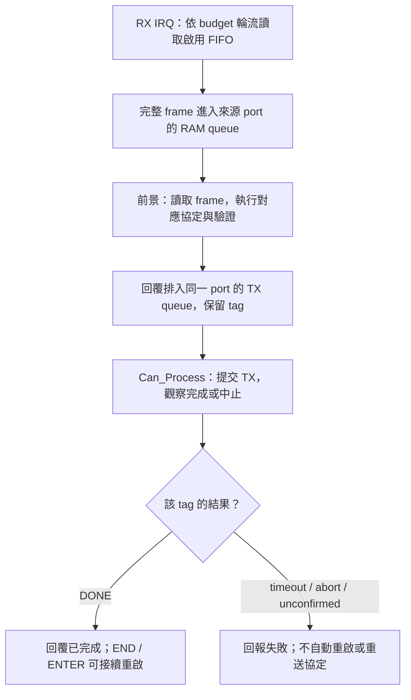
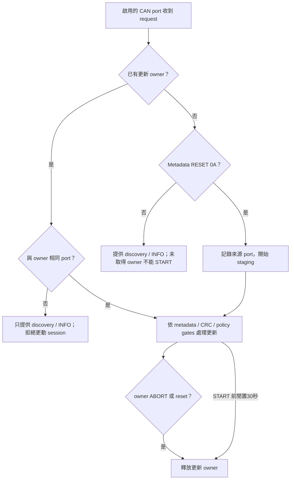
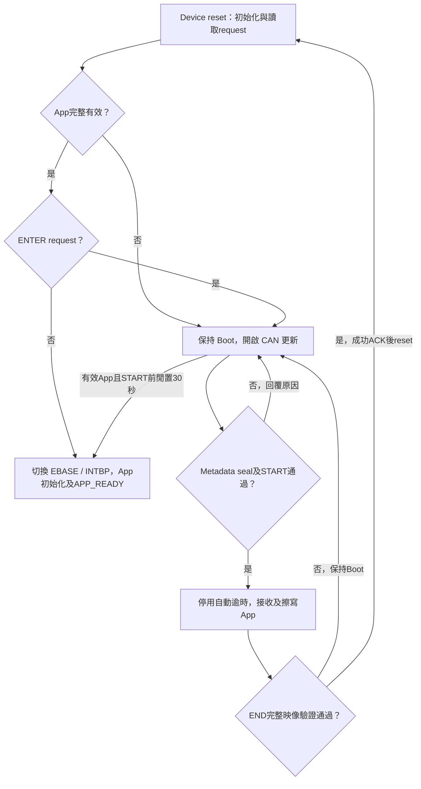
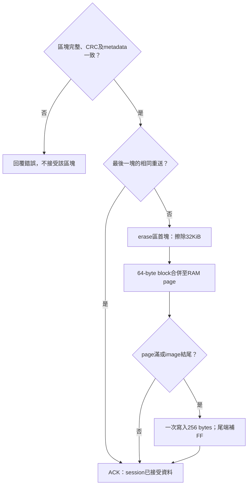

[知識庫首頁](https://released.github.io/) · [RH850 Bootloader](index.html)

<a id="article_top"></a>

# Classical CAN／CAN FD device 工程

EVM、CAN port、接收資源、更新 owner 與 Boot 啟動流程。

<!-- BOOTLOADER_TOPICS_BEGIN -->
## 本頁主題

| 章節／規格 | 本頁 | 另一平台 |
| --- | --- | --- |
| 工程與用途 | [閱讀](#guide-can-device-1) | [RL78](../slide_boot_loader_for_RL78/can-device.html#guide-can-device-1) |
| 板端與更新設定 | [閱讀](#guide-can-device-2) | [RL78](../slide_boot_loader_for_RL78/can-device.html#guide-can-device-2) |
| Flash 配置 | [閱讀](#guide-can-device-3) | [RL78](../slide_boot_loader_for_RL78/can-device.html#guide-can-device-3) |
| Boot 啟動與更新 | [閱讀](#guide-can-device-4) | [RL78](../slide_boot_loader_for_RL78/can-device.html#f13-boot-decision) |
| MCU CAN FD device 工程設定 | [閱讀](#guide-can-device-5) | [RL78](../slide_boot_loader_for_RL78/can-device.html#guide-can-device-5) |
| 設定來源 | [閱讀](#guide-can-device-6) | [RL78](../slide_boot_loader_for_RL78/can-device.html#guide-can-device-6) |
| 接收與中斷 | [閱讀](#guide-can-device-7) | [RL78](../slide_boot_loader_for_RL78/can-device.html#guide-can-device-7) |
| 更新區塊與 Flash 交接 | [閱讀](#guide-can-device-8) | [RL78](../slide_boot_loader_for_RL78/can-device.html#guide-can-device-8) |
| 工程與建置 | [閱讀](#guide-can-device-9) | [RL78](../slide_boot_loader_for_RL78/can-device.html#guide-can-device-9) |
| 驗證項目 | [閱讀](#guide-can-device-10) | [RL78](../slide_boot_loader_for_RL78/can-device.html#guide-can-device-10) |
<!-- BOOTLOADER_TOPICS_END -->

<!-- RH850_DEVICE_BEGIN -->
<a id="rh850-can-device"></a>

## RH850 MCU CAN device 工程

R7F701684 EVM 使用獨立的 Classical CAN 與 CAN FD 工程。
App 發行設定與 IRQ mapping 由 C header 編輯，PowerShell 在 CS+ 建置前產生 identity／向量表，建置後核對實際映像並封裝 BIN。

<a id="guide-can-device-1"></a>

### 工程與用途

| 模式 | Transfer | Boot | App |
| --- | --- | --- | --- |
| Classical CAN | `Sample_Project_RH850_S1_CAN_Transfer` | `Sample_Project_RH850_S1_Boot_loader_CAN` | `Sample_Project_RH850_S1_Boot_loader_CAN_app` |
| CAN FD | `Sample_Project_RH850_S1_CAN_FD_Transfer` | `Sample_Project_RH850_S1_Boot_loader_CAN_FD` | `Sample_Project_RH850_S1_Boot_loader_CAN_FD_app` |

這些名稱是工程識別；此處未提供原始碼下載網址。
Boot、App 與 Transfer 各自包含 CAN adapter、設定與建置工具，可獨立編譯。
來源分工與使用者入口見 [工程目錄與程式入口](porting.html#rh850-project-entry)。

Transfer 的共通通訊驗證與操作見 [Custom Transfer](https://released.github.io/slide_simple_renesas_isp_tool/#custom-transfer)。
一般更新與報告操作見 [Tool 操作](https://released.github.io/slide_simple_renesas_isp_tool/#tool-operation)。

<a id="guide-can-device-2"></a>

### 板端與更新設定

| 項目 | 本工程設定 | 依據／程式位置 |
| --- | --- | --- |
| MCU | RH850/F1KM-S1、R7F701684、100 pins、1 MiB Code Flash | EVM 手冊、CS+ device |
| Clock | X1 16 MHz、CPU 120 MHz、CAN communication clock 40 MHz | SC 設定、`generated_projection/evm_clock.c`、`Device_ClockInherited()` |
| CAN | CAN1 TX P10_7 Alt4／RX P10_6 Alt4；CAN4 TX P0_10 Alt5／RX P0_9 Alt5 | `can_port_config.h`、`hal/can/can_board.c` |
| Classical | nominal 500 kbit/s；standard request／response `0x700`／`0x701` | `can_boot_config.h` 與 `Device_CanInit()` |
| FD | nominal 500 kbit/s、data 2 Mbit/s、BRS、64-byte raw data frame | FD 工程的同名設定與 adapter |
| Transfer IDs | request／response `0x710`／`0x711` | 各 Transfer 的 `can_transfer_config.h` |
| UART log | UART0 TX P0_2、115200 bit/s | SC UART0；主迴圈有限次數等待，UART CPU IRQ 保持遮罩 |
| RX | 每個啟用 port 使用獨立 FIFO／16 格 SPSC queue（15 格可用），共用 EIINT23 | `Device_CanRxIsr()`；每次總計最多讀取16幀，接收無 polling fallback |
| Tick | OSTM0、EIINT84、1 ms | SC OSTM0 與 `ostmr_1ms_IRQ()` |

硬體設定來源為 [RH850/F1KM 硬體手冊](https://www.renesas.com/en/document/mah/rh850f1km-rh850f1kh-users-manual-hardware) 的時脈、Port、RS-CANFD 與中斷章節。
兩塊 EVM 的手冊皆列出 CAN／CAN FD 收發器；2 Mbit/s 的接線、終端與實際波形仍需實板核對。

<a id="rh850-evm-can-ports"></a>

#### EVM 連接、port 選擇與 CAN RAM

依據為 [BLDC Starter Kit V2 手冊](https://www.renesas.com/en/document/mat/rh850f1km-s1-bldc-starter-kit-v2-users-manual) §4.1.8.3、Tables27／28，
以及 [Starter Kit V3 手冊](https://www.renesas.com/en/document/mat/rh850f1km-s1-starter-kit-v3-user-manual-hardware) §4.2.7.3、Tables24／25。
板上 **CAN0／CAN1 連接器**分別連到 **MCU CAN1／CAN4**。

| MCU channel | 板上連接器 | BLDC V2 路由 | ASK V3 路由 |
| --- | --- | --- | --- |
| CAN1 | CAN0／CN6 | S7_6、S7_5 ON | J20 1-2、3-4 |
| CAN4 | CAN1／CN8 | S7_4、S7_2 ON；S7_3、S7_1 OFF | J20 5-6、7-8 |

獨立 bus 測試時，S4_3／S4_4 保持 OFF，避免板內將兩路互接。
S4_1／S4_2 分別控制兩路終端電阻，依實際 bus 兩端配置；兩塊板的 USB／電源與 UART 跳線也依各自手冊設定。

各工程根目錄的 `can_port_config.h` 選擇本工程的 CAN port。
搭配安裝的 Boot／App 分別設定相容的 port、速率與 ID；Transfer 使用自己的設定。
每一項填0或1，至少啟用一個 port：

```c
#define ENABLE_PORT_CAN0 (0U)
#define ENABLE_PORT_CAN1 (1U)
#define ENABLE_PORT_CAN2 (0U)
#define ENABLE_PORT_CAN3 (0U)
#define ENABLE_PORT_CAN4 (1U)
#define ENABLE_PORT_CAN5 (0U)
```

其他四路的既定 pin mapping 如下；使用時需另行配置板端接線與收發器。
來源為硬體手冊 Tables2C.41／2C.47 的100-pin alternative functions。

| MCU channel | TX | RX |
| --- | --- | --- |
| CAN0 | P0_0 Alt2 | P0_1 Alt7 |
| CAN1 | P10_7 Alt4 | P10_6 Alt4 |
| CAN2 | P0_4 Alt1 | P0_5 Alt7 |
| CAN3 | P0_8 Alt5 | P0_7 Alt7 |
| CAN4 | P0_10 Alt5 | P0_9 Alt5 |
| CAN5 | P0_14 Alt5 | P0_13 Alt7 |

| 資源 | 分配方式 | CAN1／CAN4 預設配置 |
| --- | --- | --- |
| 硬體 RX FIFO | index＝MCU channel，每路深度16 | FIFO1／FIFO4 |
| RX rule | 每路獨立 exact control ID；Boot 另有 raw rule | 不跨 FIFO 路由 |
| CPU RAM queue | 只為啟用 port 配置，16格／15可用 | 兩組獨立 queue／counter |
| TX buffer | 各 channel 的 local buffer0 | status index32／128 |
| CPU TX queue | 每路4筆，含尚未讀取的 completion credits | ISP 一次等待一筆協定回覆；實際 RAM／stack 另由 linker guard 核對 |
| RX Message Buffer／共用 TX-RX FIFO | 不配置 | 0個 |

硬體手冊 §24.10.1.5 的 RX／FIFO RAM 計算式為 `depth × (12 + payload bytes)` 加總。
六通道可用量為 `3584 × 6 = 21504 bytes`，不含固定 TX buffer 區。
Classical 每路用320 bytes；FD 每路用1216 bytes，兩路共2432 bytes，六路共7296 bytes。
程式以64-byte payload 的上界作編譯檢查；CPU RAM queue 另行計算，不與 CAN RAM 混用。

共用 RX IRQ 輪流讀取啟用 FIFO，一次總計最多16幀；滿批後再請求中斷。
Main loop 輪流讀取各路 RAM queue，response 回到 request 的來源 bus。
IRQ counter 表示該 port 在 ISR 中實際取得 frame 的入口次數，空 FIFO 不增加該計數。
Queue／drop／error observations 依 port 記錄；硬體 lost indication 不等於精確遺失幀數。

<a id="rh850-can-service"></a>

<a id="guide-can-device-7"></a>

### 接收與中斷

#### CAN service、回覆完成與錯誤處理

Classical／FD 的 Boot、App 與 Transfer 共用 MultiCHv4 的 service／driver 核心。
硬體設定與協定 adapter 則由各工程持有，沿用本頁的 EVM、mode、ID、速率及 IRQ 配置。



| 檔案／層級 | 負責內容 | 可編輯位置 |
| --- | --- | --- |
| `can_port_config.h` | 啟用的 MCU channel、靜態 RX queue／CAN RAM 上界 | 各工程根目錄 |
| `hal/can/can_config.c` | 每路 FIFO、timing、exact control／raw ID filters、初始化前資源檢查 | 工程通訊配置 |
| `hal/can/can_board.c` | EVM pin mux、實際 clock 檢查、INTC、channel-local 操作 | 板端移植 |
| `hal/can/can_service.c/.h` | 完整 frame queue、IRQ budget、TX tag／completion、timeout／cancel／診斷 | 共用核心 |
| `hal/can/rs_canfd*` | frame／DLC／FIFO／rule／共享 RAM 驗證及 register driver | 共用核心 |
| `rh850_can_ports.c/.h` | ISP API、來源 channel 回覆、wire format 檢查及 TX 完成判定 | 協定接合 |
| `device_can.c`／`rh850_can.c` | Boot／App／Transfer 的既有介面 | 各模式工程 |

各工程使用自己的 `hal/can` service／driver 與 adapter。
Firmware 建置使用工程內的副本，不需要另行取得 standalone v4 或安裝其他執行環境。

`CanPorts_Read()` 呼叫 `Can_Process()` 處理 TX／status，再讀取 RAM queue。
IRQ-owned FIFO 不由 main loop 輪詢；RX ISR 不解析協定、不輸出 UART，也不等待 TX。
`CanPorts_Send()` 只有取得相同 tag 的 `CAN_TX_DONE` 才回傳成功，排入 queue 不是傳輸完成。
既有 END／ENTER 的 reset gate 因而仍以回覆完成為條件，metadata／Flash／CRC／版本政策另由原協定檢查。

| 狀態／操作 | 行為 |
| --- | --- |
| RX queue 滿 | 保留已排入的資料，丟棄新 frame 並增加該 port 的 drop observation |
| TX 逾時 | 提交後100 ms 未完成時請求一次 abort，再以100 ms 上限觀察中止結果 |
| TX 結果未確認 | 鎖住該 channel 的 TX；不自動重新送出或重啟 CAN，其他 channel 獨立運作 |
| `Can_StopChannel()`／`Can_RecoverChannel()` | 前景 C API；恢復時清除該 channel 的 CPU RX queue，保留 completion／診斷，不重新配置其他 channel 或全域 CAN RAM |
| `Can_CancelTx(channel, tag)` | 取消最早一筆相符的 outstanding tag；硬體已完成的競爭結果仍為 DONE，未確認結果不宣稱已取消 |
| 狀態／診斷讀取 | 保留硬體 error flags；`CLEAR_STATS` 僅處理協定統計，不重設 CAN 或清除硬體錯誤證據 |

Stop／recover／cancel 不新增 Tool 操作或 CAN ISP 命令。
自訂程式使用這些 API 時，先結束目前協定交易並保存診斷；它們不釋放 Boot 的更新 owner，也不解除更新保護。
Boot 更新工作區的規則集中於[多 port 更新工作區](#rh850-update-port-owner)。

<a id="rh850-update-port-owner"></a>

#### 多 port 更新工作區

Transfer 的 protocol context、統計與重送快取依 port 獨立。
Boot 的 App Flash 與 metadata staging 則只有一份，採單一更新 owner：



非 owner 的更動命令回覆 `BAD_STATE=2`，detail 為 owner 的 MCU channel；raw data／BEGIN 不回覆、不進入工作區。
收到其他 bus 的 discovery／INFO 不會延長既有 staging lease。
START 後不自動釋放或讓另一 port 接管；由 owner ABORT 或重置結束工作階段。
ABORT 清除 RAM session，不還原已擦寫的 App。

個別測試時將 host 接到 CAN1，完成 Transfer 或更新；再改接 CAN4 重做相同流程。
Tool 的 Bridge port 選單選擇的是 **host 的 port**，device port 由實際接線及上述編譯設定決定。

<a id="guide-can-device-3"></a>

### Flash 配置

Boot64KiB、App起點10000h及RAM monitor／FCL配置集中於 [Flash與映像配置](porting.html#rh850-flash-layout)。
App、Transfer與燒錄器檔案的範圍依各自的封裝產物核對。

<a id="guide-can-device-9"></a>

### 工程與建置

Boot／App／Transfer均在自己的根目錄使用`build.ps1`或CS+ Rebuild。
完整產物表見 [建置與使用產物](app-development.html#rh850-build-products)。

<a id="guide-can-device-10"></a>

### 驗證項目

| 項目 | 本工程的核對內容 |
| --- | --- |
| Clock／pin | R7F701684、16MHz、CPU120／CAN40MHz、CAN1／CAN4路由 |
| 接收 | 共用RX IRQ、各port獨立FIFO與CPU queue、overflow／drop observations |
| 回覆 | source port、TX tag／DONE、完整回覆後才允許reset |
| 更新契約 | Metadata／target／mode／rate／layout／policy／CRC／vectors |
| Flash | FCL RAM鏈、38個blocks、256-byte page、Boot範圍保護 |
| App | EBASE／完整INTBP、APP_READY、live identity與獨立counter |

<a id="rh850-boot-flow"></a>

<a id="guide-can-device-4"></a>

### Boot 啟動與更新

#### 更新與啟動流程

App 有效性包含 metadata、CRC、entry、exception 及512-entry IRQ table。
更新後由 Tool 的 APP_READY 及 live identity／version／build／size 比對確認 App；100% 本身不是 App 已執行的證據。

交接時停止本次 Boot 已啟用的周邊。
CAN adapter 的 `CanPorts_Stop()` 以 `Can_IsReady()` 確認服務狀態；有效 App 直接啟動且尚未開啟 CAN 時直接返回，
已啟用 CAN 時則完成控制器停止與待送資料清理，再交接給 App。



<a id="guide-can-device-5"></a>

## MCU CAN FD device 工程設定

<a id="guide-can-device-6"></a>

### 設定來源

| 項目 | FD工程設定 | 修改來源 |
| --- | --- | --- |
| Mode／BRS | FD+BRS，control8bytes／raw64bytes | FD工程`RH850_CAN_FD`、`can_boot_config.h`與adapter |
| Clock／timing | CAN40MHz，nominal500K／data2M | `hal/can/can_config.c`及`rs_canfd.h`timing preset |
| IDs | control700h／reply701h，raw720h | CAN設定header與各port exact filters |
| RX | 每個啟用port各有16-depth FIFO及CPU queue | `can_port_config.h`與CAN service |
| IRQ | 共用RX EIINT23；tick84 | SC／工程table與ISR |
| 映像 | format6、256-byte Metadata、64KiB Boot、R8V1 IRQ ABI | 中性image配置與實際post-build guards |

### Flash與建置

FD沿用本工程的256-byte Flash page與FCL RAM鏈；完整mapping、產物與建置命令集中於 [移植與Flash](porting.html) 及 [App建置](app-development.html#rh850-build-products)。

<!-- RH850_PAGE_BEGIN -->
<a id="rh850-can-page-flow"></a>

<a id="guide-can-device-8"></a>

### 更新區塊與 Flash 交接

<a id="rh850-can-block-write"></a>

#### CAN 區塊與 Flash page

Tool 先完成 BIN／live 契約比對、metadata staging／seal 與 START，再依序傳送 BEGIN／raw data／COMMIT。
每個 COMMIT 的處理如下。



CAN Classical 的 raw ID 為 `0x720..0x727`，每幀最多8 bytes；CAN FD 使用 `0x720`／DLC15／64 bytes。
控制幀及 byte 格式見 [CAN frame reference](reference.html#rh850-can-frames)。
每次 COMMIT 接受最多64 bytes；ACK 表示該 session 已接受區塊，未滿256-byte page 的資料仍在 RAM。
最後一塊重送由 RAM cache 核對，不再次擦寫。
斷電會遺失未寫滿的 RAM page；重新上電依完整映像驗證決定留在 Boot 或啟動有效 App，更新重新從起點進行。

擦寫由 FCL internal-handler mode 的 RAM 執行鏈完成，期間 IRQ 遮罩。
可能空白或中斷的 Flash 資料由 RAM reader 暫時關閉 VCI data ECC 後讀取並恢復設定；PE instruction ECC 不變。
這是 raw data／CRC 檢查，不是硬體 blank check 或 ECC 狀態驗證。

<!-- RH850_PAGE_END -->
<!-- RH850_DEVICE_END -->

---

[指南入口](index.html) · [下一主題：App Metadata、IRQ 與更新耗時](app-development.html)
