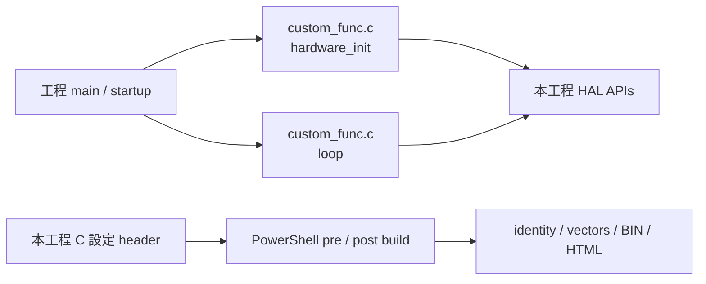
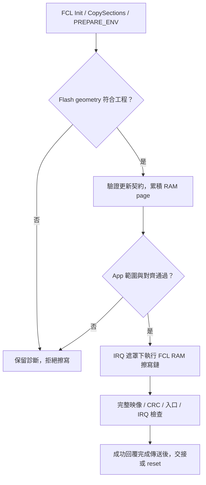

[知識庫首頁](https://released.github.io/) · [RH850 Bootloader](index.html)

# Boot／App 移植與 Flash

位址、HAL 入口、FCL RAM 執行、startup 與映像交接。

<!-- RH850_PORTING_CHAPTER_BEGIN -->

### Flash 與 RAM 位址

以下為 byte address，範圍包含起訖。
Flash erase／write 單位依 [Flash hardware interface](https://www.renesas.com/en/document/mah/rh850f1k-users-manual-flash-hardware-interface) 及 FCL 裝置資訊核對。

| 區域 | 位址／大小 | 用途與來源 |
| --- | --- | --- |
| Boot | `0x00000000..0x0000FFFF`，64 KiB | reset／Boot INTBP／FCL／驗證；保留至少512 bytes 建置餘裕 |
| App entry | `0x00010000..0x000100FF` | 起始 `jr32 __start` 與預留；`app_entry.asm` |
| App metadata | `0x00010100..0x000101FF`，256 bytes | core128＋reserved128；`image_metadata_profile.c` |
| App exception table | `0x00010200..0x000103FF`，512 bytes | EBASE；32個16-byte exception slots |
| App EIINT table | `0x00010400..0x00010BFF`，2048 bytes | INTBP；512個 LE32 handler address |
| App code／constants | `0x00011000` 起 | `device_build.ps1` linker layout |
| App capacity | `0x00010000..0x000FFFFF`，960 KiB | 實際 image 最後4 bytes 為 CRC32，依 image size 決定位置 |
| Flash erase | Boot block0..7各8 KiB；App block8..37各32 KiB | FCL 初始化核對38 blocks、block7 end及最後 block end |
| Flash program | 256-byte aligned page | `flash_geometry.c`、`Device_FlashWritePage()` |
| 一般 RAM／stack | `0xFEDF0000` 起，使用範圍限制於 `0xFEDF4800` 前 | post-build map guard |
| E2 monitor 預留 | `0xFEDF4800..0xFEDF6DFF` | CS+ Work RAM 使用 global alias `0xFEBF4800`、9728 bytes |
| RAM reader | `0xFEDF7000..0xFEDF7FFF`，4 KiB | copied `RAM_READ.text`；解析可能空白的 Flash 資料 |
| FCL copy 預留 | `0xFEDF8000..0xFEDFEFFF`，28 KiB | `FCL_RAM_ADDRESS`；post-build 檢查區段次序與 copy extent |
| RAM handoff | `0xFEDFFFF0..0xFEDFFFFF`，16 bytes | signature／request／反碼／owner；`boot_app_handoff.h` |

Cold reset 初始化 handoff RAM 的 ECC；Boot→App 與 software reset 保留已初始化的 cookie。
EVM startup 的 LRAM ECC 初始化從 `0xFEDE0000` 開始，涵蓋96 KiB LRAM；上表為本工程目前實際配置的子區域。
Cookie 是啟動交接資訊，不是認證機制，也不是斷電後保留的版控儲存區。

## 工程目錄與使用者入口

Boot、App、Custom Transfer 各自包含來源、設定與 PowerShell 工具。
在所選工程根目錄執行 `build.ps1`，只建置該工程。
`custom_func.c` 的 `hardware_init()` 負責初始化，`loop()` 接續處理前景工作。

| 位置 | 負責內容 | 常見修改 |
| --- | --- | --- |
| `custom_func.c` | 初始化順序、前景協定處理、App 工作與文字 Log | 加入 App 初始化及週期工作 |
| `hal/can` | CAN profile、pin／clock binding、RX queue、TX completion | CAN port、timing 與板端配置 |
| `hal/device` | MCU／周邊與板端 API | UART、timer、GPIO 與板端移植 |
| `hal/image` | Metadata profile／parser、映像、CRC 與交接相關 API | 映像契約及架構相關驗證 |
| `hal/flash` | FCL、Flash geometry 與擦寫 adapter | 目標 Flash 幾何與 RAM 執行配置 |
| `hal/isp` | CAN 或串列更新／Transfer 引擎 | 通訊狀態、封包、staging 與重送 |
| 工程根目錄的設定 header | App 發行、MCU／Flash、介面、IRQ、RAM handoff | 對應契約的可編輯輸入 |
| `src`／`generated_projection` | SC 原稿及工程受控產物 | SC 設定；生成檔由建置流程維護 |

各工程保留實際使用的目錄。Flash library 原廠檔案維持既有結構。
程式內的英文註解說明 API 邊界與關鍵條件；完整 App 編輯步驟見 [App 設定與 IRQ](app-development.html#rh850-app-editing)。

## Flash library 與 RAM 執行

Boot 使用 RH850 FCL internal-handler mode。
`Device_FlashInit()` 依序執行 `R_FCL_Init()`、`R_FCL_CopySections()` 與 `R_FCL_CMD_PREPARE_ENV`，再讀回並核對 Flash block 數量與邊界。
程式區段與呼叫鏈需符合 FCL 的 RAM 執行條件，傳輸介面本身不直接呼叫 library。

| 階段 | 對應程式／動作 | 核對內容 |
| --- | --- | --- |
| 設定 | 工程註冊的 `fcl_descriptor.c` 與 FCL 設定 | MCU、時脈、工作區與 library 模式 |
| 建立執行環境 | `hal/flash/device_flash.c` 的 `Device_FlashInit()` | RAM 位址、copy 成功、PREPARE_ENV 與 geometry |
| 擦除 | `Device_FlashErase()` | 已完成初始化、App block 邊界及 Boot 保護 |
| 寫入 | `Device_FlashWritePage()` | 256-byte page 對齊、buffer 對齊及 App 範圍 |
| 讀取／驗證 | `hal/image` 的映像及 RAM reader API | Metadata、完整 CRC、入口與 IRQ 目的地 |
| 建置後檢查 | `tools/device_build.ps1` 與相關 guard | 實際 linker map、RAM copy extent 與受限執行鏈 |

CAN 的 64-byte 更新區塊先累積於 RAM，形成完整 256-byte Flash page 後才寫入。
最後不足一頁的部分以 FF 補齊。區塊 ACK、實體 page 寫入與 END 完整映像驗證分別代表不同階段。

RAM reader 處理可能空白或更新中斷的 Flash 資料，並依現有 API 暫時處理 data ECC 控制後恢復設定。
這是映像資料讀取流程；電氣時序、ECC fault 與中斷／斷電測試分別依實板條件驗證。

## Startup、RAM 與 IRQ 交接

EVM 使用 R7F701684、外部 16 MHz，工程配置 CPU 120 MHz、CAN communication clock 40 MHz。
Boot 建立時脈與 RAM／ECC 狀態；App 接續核對交接時脈，再初始化自己的周邊。

| 項目 | Boot／App 配置 | 修改時的來源 |
| --- | --- | --- |
| Boot 分區 | 起點 0；預留 64 KiB | `image_metadata_config.h`、linker 與實際 map |
| App 入口 | `0x10000` 的跳轉入口 | `app_entry.asm` 與實際封裝 BIN |
| Exception table | App EBASE 指向 `0x10200` | App startup／exception stub |
| EIINT table | App INTBP 指向 `0x10400`，512 entries | `app_irq_handlers.h`、產表工具及 linker |
| RAM cookie | signature、request、反碼與 AA／55 owner | 本機 `boot_app_handoff.h` 與 handoff API |
| FCL／RAM reader | 專用 RAM 區域及可執行範圍 | Flash／image API、linker 與 post-build guard |

Boot→App 交接會先遮罩中斷、停止 Boot 周邊、更新 RAM cookie，再透過 assembly 入口設定 App 的 EBASE／INTBP。
App 的一般 EIINT 依 App table 直接取得 handler；完整路徑與新增 IRQ 步驟見 [IRQ 編輯](app-development.html#rh850-app-editing)。

## 平台移植核對

| 變動 | 一起核對的內容 |
| --- | --- |
| MCU／Flash 容量 | device header、FCL 支援、block geometry、RAM／ECC 範圍 |
| Boot 大小／App 起點 | 兩個工程的 image contract、entry、EBASE／INTBP、linker、封裝與 Tool 契約 |
| IRQ mapping | 硬體 EIINT index、global ISR、SC、產表與實際目的地 |
| CAN port／速率 | pins／transceiver、driver timing、資源配置、Boot／App metadata 與 Tool |
| UART／I2C／Xmodem | 獨立資料介面、Log、rate／address、IRQ 與完整回覆後動作 |

App 功能、版本與既定 IRQ mapping 的修改使用 App-only 建置。
改動跨映像的配置時，分別更新並核對搭配安裝的 Boot 與 App。
<!-- RH850_PORTING_CHAPTER_END -->

---

[上一主題：UART／Xmodem／I2C device 工程](serial-device.html) · [指南入口](index.html) · [下一主題：映像、Metadata 與 CAN 封包參考](reference.html)
