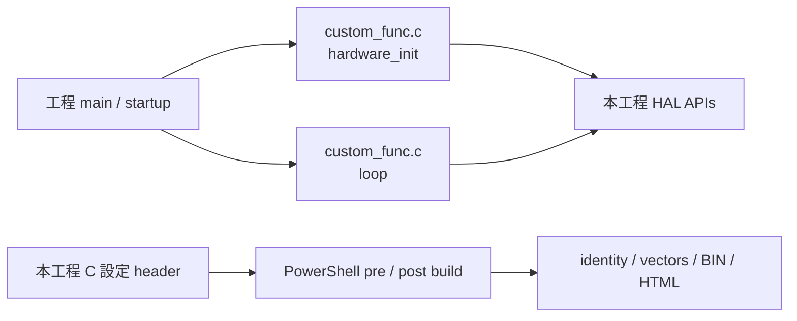
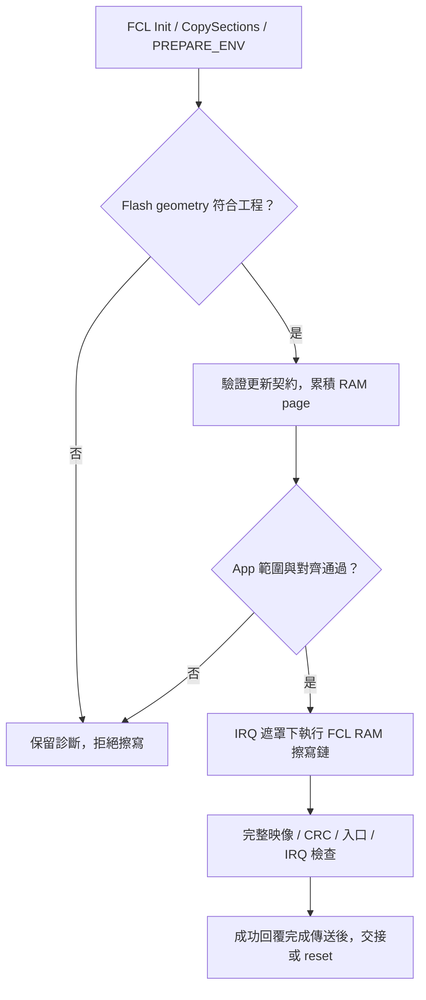

[知識庫首頁](https://released.github.io/) · [RH850 Bootloader](index.html)

# Boot／App 移植與 Flash

位址、HAL 入口、FCL RAM 執行、startup 與映像交接。

<!-- BOOTLOADER_TOPICS_BEGIN -->
## 本頁主題

| 章節／規格 | 本頁 | 另一平台 |
| --- | --- | --- |
| Basic 範例與 CAN golden sample | [閱讀](#guide-porting-1) | [RL78](../slide_boot_loader_for_RL78/porting.html#guide-porting-1) |
| 1. 工程來源 | [閱讀](#guide-porting-2) | [RL78](../slide_boot_loader_for_RL78/porting.html#guide-porting-2) |
| 2. Flash 與映像配置 | [閱讀](#guide-porting-3) | [RL78](../slide_boot_loader_for_RL78/porting.html#guide-porting-3) |
| 重要事項：Boot 燒錄方式與 Flash 尾端保護 | [閱讀](#guide-porting-4) | [RL78](../slide_boot_loader_for_RL78/porting.html#guide-porting-4) |
| 3. Startup、RAM 與中斷交接 | [閱讀](#guide-porting-5) | [RL78](../slide_boot_loader_for_RL78/porting.html#guide-porting-5) |
| 使用者程式入口與 Generate Code | [閱讀](#guide-porting-6) | [RL78](../slide_boot_loader_for_RL78/porting.html#guide-porting-6) |
| Code Flash 擦寫：ROM 儲存與 RAM 執行 | [閱讀](#guide-porting-7) | [RL78](../slide_boot_loader_for_RL78/porting.html#guide-porting-7) |
| 映像 CRC32 與硬體 CRC | [閱讀](#guide-porting-8) | [RL78](../slide_boot_loader_for_RL78/porting.html#guide-porting-8) |
| 4. 固定向量介面 | [閱讀](#guide-porting-9) | [RL78](../slide_boot_loader_for_RL78/porting.html#guide-porting-9) |
| 5. 設定檔與建置 | [閱讀](#guide-porting-10) | [RL78](../slide_boot_loader_for_RL78/porting.html#guide-porting-10) |
| 6. 初次安裝與後續更新 | [閱讀](#guide-porting-11) | [RL78](../slide_boot_loader_for_RL78/porting.html#guide-porting-11) |
| 7. 啟動與更新流程 | [閱讀](#guide-porting-12) | [RL78](../slide_boot_loader_for_RL78/porting.html#guide-porting-12) |
| 8. App 變更與驗證 | [閱讀](#guide-porting-13) | [RL78](../slide_boot_loader_for_RL78/porting.html#guide-porting-13) |
<!-- BOOTLOADER_TOPICS_END -->

<!-- RH850_PORTING_CHAPTER_BEGIN -->
## MCU CAN device：Boot 與 App 工程

### Basic 範例與 CAN golden sample

本指南以包含 Metadata、IRQ、版本政策與完整映像 CRC 的 ISP 工程為配置基準。
對照簡易 Boot 或導入其他 RH850 專案時，可依下表選擇需要保留的契約。

| 項目 | 此 RH850 ISP 工程的規格 | 導入其他 Boot 時核對 |
| --- | --- | --- |
| 更新入口 | 單一資料介面的 Boot／App，另有獨立診斷 Log | 接線、協定、回覆完成與 reset |
| 映像 | App entry、256-byte Metadata、exception、512-entry INTBP、code與CRC | linker／封裝／Boot驗證使用相同layout |
| 工程配置 | C header／本機PowerShell生成與post-build實際映像檢查 | 編輯輸入與自動產物分開 |
| 啟動保護 | profile／範圍／IRQ目的地／CRC／有效App版本政策 | 啟動與更新均套用相同契約 |
| Flash | FCL RAM執行、geometry與App範圍保護 | 使用目標MCU支援的library與RAM配置 |

### 1. 工程來源

CAN／CAN FD 的 Boot、App、Transfer 是獨立工程；串列 ISP 亦各自持有來源與工具。
具體名稱見 [工程與用途](can-device.html#rh850-can-device) 與 [串列工程](serial-device.html)。
App 功能修改從該 App 的 `custom_func.c`、`app_image_config.h` 及 `app_irq_handlers.h` 開始。

#### 依修改目的選擇設定入口

| 修改目的 | 主要編輯位置 | Boot 是否需要配套修改 |
| --- | --- | --- |
| App 功能、版本或一般 IRQ | App `custom_func.c`、ISR、`app_image_config.h`、`app_irq_handlers.h` | 契約及既有轉送範圍內不需重建 Boot；App Rebuild 後核對報告 |
| 更新介面、速率、ID／address | Boot／App 通訊 header、SC／driver、metadata profile及Tool選項 | 需要；單一介面的工程分別設定，另保留診斷UART |
| Flash 分區或容量 | `image_metadata_config.h`、linker、startup、封裝與Flash backend | 需要；核對 erase／write 單位、保護範圍及安裝方式 |
| 新 MCU／板子 | MCU header、clock／pin、IRQ配置、RAM、Flash library及上述契約 | 需要；先完成獨立Boot／App／Transfer建置及板端驗證 |

### 2. Flash 與映像配置

### Flash 與 RAM 位址

以下為 byte address，範圍包含起訖。
Flash erase／write 單位依 [Flash hardware interface](https://www.renesas.com/en/document/mah/rh850f1k-users-manual-flash-hardware-interface) 及 FCL 裝置資訊核對。

| 區域 | 位址／大小 | 用途與來源 |
| --- | --- | --- |
| Boot | `0x00000000..0x0000FFFF`，64 KiB | reset／Boot INTBP／FCL／驗證；保留至少512 bytes 建置餘裕 |
| App entry | `0x00010000..0x000100FF` | 起始 `jr32 __start` 與預留；`app_entry.asm` |
| App metadata | `0x00010100..0x000101FF`，256 bytes | core128＋reserved128；`image_metadata_profile.c` |
| App exception table | `0x00010200..0x000103FF`，512 bytes | EBASE；32個16-byte exception slots |
| App EIINT table | `0x00010400..0x00010BFF`，2048 bytes | INTBP；512個 LE32 handler address |
| App code／constants | `0x00011000` 起 | `device_build.ps1` linker layout |
| App capacity | `0x00010000..0x000FFFFF`，960 KiB | 實際 image 最後4 bytes 為 CRC32，依 image size 決定位置 |
| Flash erase | Boot block0..7各8 KiB；App block8..37各32 KiB | FCL 初始化核對38 blocks、block7 end及最後 block end |
| Flash program | 256-byte aligned page | `flash_geometry.c`、`Device_FlashWritePage()` |
| 一般 RAM／stack | `0xFEDF0000` 起，使用範圍限制於 `0xFEDF4800` 前 | post-build map guard |
| E2 monitor 預留 | `0xFEDF4800..0xFEDF6DFF` | CS+ Work RAM 使用 global alias `0xFEBF4800`、9728 bytes |
| RAM reader | `0xFEDF7000..0xFEDF7FFF`，4 KiB | copied `RAM_READ.text`；解析可能空白的 Flash 資料 |
| FCL copy 預留 | `0xFEDF8000..0xFEDFEFFF`，28 KiB | `FCL_RAM_ADDRESS`；post-build 檢查區段次序與 copy extent |
| RAM handoff | `0xFEDFFFF0..0xFEDFFFFF`，16 bytes | signature／request／反碼／owner；`boot_app_handoff.h` |

Cold reset 初始化 handoff RAM 的 ECC；Boot→App 與 software reset 保留已初始化的 cookie。
EVM startup 的 LRAM ECC 初始化從 `0xFEDE0000` 開始，涵蓋96 KiB LRAM；上表為本工程目前實際配置的子區域。
Cookie 是啟動交接資訊，不是認證機制，也不是斷電後保留的版控儲存區。

#### 重要事項：Boot 燒錄方式與 Flash 尾端保護

| 項目 | 此 R7F701684 工程的配置／檢查 |
| --- | --- |
| Boot安裝檔 | `boot0000_FFFF.hex`，範圍0..FFFF；先核對目標MCU與燒錄範圍 |
| App完整容量 | 960KiB，起點10000h、上限FFFFFh；長度含Metadata、IRQ、填充與CRC |
| 滿容量CRC位置 | FFFFCh..FFFFFh；由實際image_size決定，不是另一段獨立保留資料 |
| E2 monitor | 預留在RAM FEDF4800h..FEDF6DFFh；CS+設定的global alias為FEBF4800h、9728bytes |
| CS+下載後 | 核對實際Boot映像、clock與Work RAM設定；離開debug後依獨立運行條件測試 |
| 燒錄器安裝後 | 以工具readback／compare核對Boot範圍；再用同一份App BIN驗證啟動 |

此工程的 monitor RAM、RAM reader及FCL區域由linker／post-build guard分開保護。
更換MCU、debug工具或分區時，重新核對相應工具設定與完整映像末端，不沿用其他MCU的保留量。

### 3. Startup、RAM 與中斷交接

#### Startup、RAM 與 IRQ 交接

EVM 使用 R7F701684、外部 16 MHz，工程配置 CPU 120 MHz、CAN communication clock 40 MHz。
Boot 建立時脈與 RAM／ECC 狀態；App 接續核對交接時脈，再初始化自己的周邊。

| 項目 | Boot／App 配置 | 修改時的來源 |
| --- | --- | --- |
| Boot 分區 | 起點 0；預留 64 KiB | `image_metadata_config.h`、linker 與實際 map |
| App 入口 | `0x10000` 的跳轉入口 | `app_entry.asm` 與實際封裝 BIN |
| Exception table | App EBASE 指向 `0x10200` | App startup／exception stub |
| EIINT table | App INTBP 指向 `0x10400`，512 entries | `app_irq_handlers.h`、產表工具及 linker |
| RAM cookie | signature、request、反碼與 AA／55 owner | 本機 `boot_app_handoff.h` 與 handoff API |
| FCL／RAM reader | 專用 RAM 區域及可執行範圍 | Flash／image API、linker 與 post-build guard |

Boot→App 交接會先遮罩中斷、停止 Boot 周邊、更新 RAM cookie，再透過 assembly 入口設定 App 的 EBASE／INTBP。
App 的一般 EIINT 依 App table 直接取得 handler；完整路徑與新增 IRQ 步驟見 [IRQ 編輯](app-development.html#rh850-app-editing)。

#### 使用者程式入口與 Generate Code

##### 工程目錄與使用者入口

Boot、App、Custom Transfer 各自包含來源、設定與 PowerShell 工具。
在所選工程根目錄執行 `build.ps1`，只建置該工程。
`custom_func.c` 的 `hardware_init()` 負責初始化，`loop()` 接續處理前景工作。

| 位置 | 負責內容 | 常見修改 |
| --- | --- | --- |
| `custom_func.c` | 初始化順序、前景協定處理、App 工作與文字 Log | 加入 App 初始化及週期工作 |
| `hal/can` | CAN profile、pin／clock binding、RX queue、TX completion | CAN port、timing 與板端配置 |
| `hal/device` | MCU／周邊與板端 API | UART、timer、GPIO 與板端移植 |
| `hal/image` | Metadata profile／parser、映像、CRC 與交接相關 API | 映像契約及架構相關驗證 |
| `hal/flash` | FCL、Flash geometry 與擦寫 adapter | 目標 Flash 幾何與 RAM 執行配置 |
| `hal/isp` | CAN 或串列更新／Transfer 引擎 | 通訊狀態、封包、staging 與重送 |
| 工程根目錄的設定 header | App 發行、MCU／Flash、介面、IRQ、RAM handoff | 對應契約的可編輯輸入 |
| `src`／`generated_projection` | SC 原稿及工程受控產物 | SC 設定；生成檔由建置流程維護 |

各工程保留實際使用的目錄。Flash library 原廠檔案維持既有結構。
程式內的英文註解說明 API 邊界與關鍵條件；完整 App 編輯步驟見 [App 設定與 IRQ](app-development.html#rh850-app-editing)。

SC 原稿與自訂入口分開維護：先在SC調整周邊，產生後使用本工程的受控projection與來源註冊。
`main.c`／startup adapter接入`hardware_init()`及`loop()`；新增App功能放在`custom_func.c`，不新增第二個main。

#### Code Flash 擦寫：ROM 儲存與 RAM 執行

##### Flash library 與 RAM 執行

Boot 使用 RH850 FCL internal-handler mode。
`Device_FlashInit()` 依序執行 `R_FCL_Init()`、`R_FCL_CopySections()` 與 `R_FCL_CMD_PREPARE_ENV`，再讀回並核對 Flash block 數量與邊界。
程式區段與呼叫鏈需符合 FCL 的 RAM 執行條件，傳輸介面本身不直接呼叫 library。

| 階段 | 對應程式／動作 | 核對內容 |
| --- | --- | --- |
| 設定 | 工程註冊的 `fcl_descriptor.c` 與 FCL 設定 | MCU、時脈、工作區與 library 模式 |
| 建立執行環境 | `hal/flash/device_flash.c` 的 `Device_FlashInit()` | RAM 位址、copy 成功、PREPARE_ENV 與 geometry |
| 擦除 | `Device_FlashErase()` | 已完成初始化、App block 邊界及 Boot 保護 |
| 寫入 | `Device_FlashWritePage()` | 256-byte page 對齊、buffer 對齊及 App 範圍 |
| 讀取／驗證 | `hal/image` 的映像及 RAM reader API | Metadata、完整 CRC、入口與 IRQ 目的地 |
| 建置後檢查 | `tools/device_build.ps1` 與相關 guard | 實際 linker map、RAM copy extent 與受限執行鏈 |

CAN 的 64-byte 更新區塊先累積於 RAM，形成完整 256-byte Flash page 後才寫入。
最後不足一頁的部分以 FF 補齊。區塊 ACK、實體 page 寫入與 END 完整映像驗證分別代表不同階段。

RAM reader 處理可能空白或更新中斷的 Flash 資料，並依現有 API 暫時處理 data ECC 控制後恢復設定。
這是映像資料讀取流程；電氣時序、ECC fault 與中斷／斷電測試分別依實板條件驗證。

#### 映像 CRC32 與硬體 CRC

| 項目 | 工程規格／選擇依據 |
| --- | --- |
| 完整映像CRC | CRC32/ISO-HDLC，reflected polynomial EDB88320h，initial／final XOR FFFFFFFFh |
| 計算範圍 | App BIN除末端4bytes；包含entry、Metadata、exception／INTBP、code與填充 |
| 軟體後端 | `hal/image/device_image.c` 的 `Device_Crc32Update()`／`Device_Crc32()` |
| Flash讀取 | 由安全read callback提供RAM資料；CRC算法不直接依賴CAN、FCL或周邊暫存器 |
| 使用軟體CRC的作用 | PC封裝器與各MCU使用相同輸入、byte順序及check vector，可逐byte比對 |
| 換成硬體後端 | 先核對poly、reflection、seed、final XOR、餵入順序及尾數處理，再用相同向量與實際BIN比對 |

標準檢查字串`123456789`的結果為`CBF43926h`。
更換CRC後端可以保留相同映像格式；讀取Code Flash的ECC及RAM執行條件仍由平台API負責。
演算法與完整位址範圍見 [CRC參考](reference.html#rh850-crc-reference)。

### 4. 固定向量介面

| 項目 | RH850 App規格 |
| --- | --- |
| App entry | 10000h的跳轉入口 |
| Exception table | EBASE=10200h，32個16-byte slots |
| EIINT table | INTBP=10400h，512個4-byte handler addresses |
| Mapping輸入 | `app_irq_handlers.h`，數字為EIINT channel index |
| 交接時 | Boot遮罩IRQ、停止周邊，設定App EBASE／INTBP及PSW.EBV後進入App startup |
| App IRQ時 | table reference直接使用App table；CC-RH ISR以EIRET返回 |

新增ISR與mapping的完整步驟見 [App Vector Table](app-development.html#rh850-app-editing)。
表格位置與大小固定；Boot／App各自連結並各自驗證目的地。

### 5. 設定檔與建置

| 類型 | 使用者編輯 | 建置核對 |
| --- | --- | --- |
| App identity／IRQ | `app_image_config.h`／`app_irq_handlers.h` | pre-build產生identity／512-entry table |
| MCU／Flash／ISP | `image_metadata_config.h`及介面設定header | 兩映像契約、linker、實際timing／pin |
| RAM／Flash API | `hal/device`／`hal/image`／`hal/flash` | ECC、FCL copy extent、Flash geometry及受限呼叫鏈 |
| 使用者流程 | `custom_func.c` | source registration、連結入口及初始化順序 |

在所選工程根目錄執行 `powershell -NoProfile -ExecutionPolicy Bypass -File .\build.ps1`，或CS+ Rebuild。
每次只建置選定工程；App-only不需要Boot checkout，也不重建或改寫Boot產物。

### 6. 初次安裝與後續更新

1. 依板端MCU、clock與工程契約準備Boot及App；保留燒錄器／CS+可辨識的帶位址檔。
2. 安裝Boot使用`boot0000_FFFF.hex`；直接安裝App使用`flash_app_variable_CRC.hex`，分別核對燒錄範圍。
3. 透過ISP更新App時，在Tool載入該App的`*_update.bin`；依discovery結果進入Boot再更新。
4. 完成後核對END、App確認、live identity及獨立Log；報告由Tool保留。

產物差異集中於 [建置與使用產物](app-development.html#rh850-build-products)，操作步驟見 [Tool入口](tool-guides.html)。

### 7. 啟動與更新流程

Boot每次啟動檢查映像與向量，更新前另檢查Metadata／policy，完整回覆完成才執行後續交接。
狀態與分支集中於 [Boot啟動與更新](can-device.html#rh850-boot-flow)，Flash資料累積見 [更新區塊與Flash交接](can-device.html#rh850-can-page-flow)。

### 8. App 變更與驗證

#### 平台移植核對

| 變動 | 一起核對的內容 |
| --- | --- |
| MCU／Flash 容量 | device header、FCL 支援、block geometry、RAM／ECC 範圍 |
| Boot 大小／App 起點 | 兩個工程的 image contract、entry、EBASE／INTBP、linker、封裝與 Tool 契約 |
| IRQ mapping | 硬體 EIINT index、global ISR、SC、產表與實際目的地 |
| CAN port／速率 | pins／transceiver、driver timing、資源配置、Boot／App metadata 與 Tool |
| UART／I2C／Xmodem | 獨立資料介面、Log、rate／address、IRQ 與完整回覆後動作 |

App 功能、版本與既定 IRQ mapping 的修改使用 App-only 建置。
改動跨映像的配置時，分別更新並核對搭配安裝的 Boot 與 App。
<!-- RH850_PORTING_CHAPTER_END -->

---

[上一主題：Xmodem Bootloader 與協定格式](xmodem-device.html) · [指南入口](index.html) · [下一主題：Flash、Metadata 與 CAN 封包參考](reference.html)
