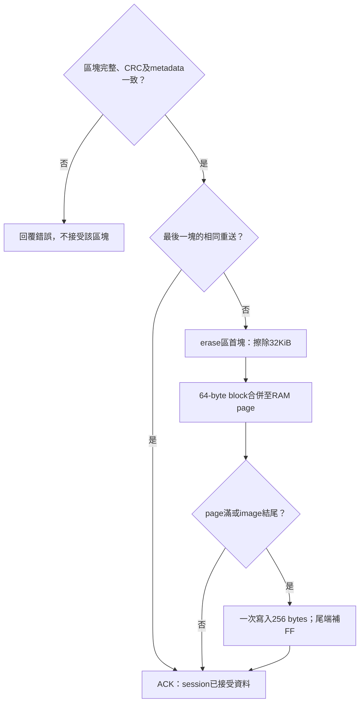

[知識庫首頁](https://released.github.io/) · [RH850 Bootloader](index.html)

# 映像、Metadata 與 CAN 封包參考

RH850 位址、256-byte Metadata 範例、8-byte control 與 raw data。

<!-- RH850_REFERENCE_CHAPTER_BEGIN -->

## 映像與位址基準

| 資料 | 基準與換算 | 產生／使用端 |
| --- | --- | --- |
| App BIN offset | 從 App entry 起算；Flash address＝`0x10000 + offset` | 封裝器、Boot reader 與 Tool |
| Metadata offset | 從 metadata 起算；Flash address＝`0x10100 + offset` | `image_metadata_profile.c`／`image_metadata.c` |
| Exception slot | `0x10200 + slot × 16` | App startup／EBASE |
| EIINT entry | `0x10400 + channel × 4` | `app_irq_handlers.h`、產表及 INTBP |
| CRC trailer | `App start + image_size - 4` | post-build；Boot 在 END 及啟動驗證 |

多 byte 數值使用 little-endian；ASCII 依字元順序並以 NUL 補齊。
Metadata 長度固定 256 bytes，由 128-byte core 與 128-byte FF reserved 組成。
CRC32/ISO-HDLC 涵蓋 App BIN 除末端4 bytes 以外的全部資料，包含 Metadata 與向量區。

## Metadata 欄位與逐 byte 範例

欄位的含義由本機 `image_metadata_config.h`、`can_boot_config.h` 與 `hal/image/image_metadata_profile.c` 定義。
App version／build／policy 使用 `app_image_config.h`，實際 image size 與 CRC 由封裝器產生。
下表的 bytes 是一份通過封裝檢查的工程 BIN 範例，與更新時間量測的輸入分別標示來源。

<!-- RH850_METADATA_BYTES_BEGIN -->
範例來源：<code>Sample_Project_RH850_S1_Boot_loader_CAN_FD_app_update.bin</code>，29860 bytes；SHA256＝<code>BBABB12466EB8BFA243EB96D73CC26BCDE6CB3F14450B93D05FC6955A8A62979</code>。
封裝 BIN 的 CRC32 與 metadata size 已相互核對；此範例值不是可直接沿用的 MCU／Flash 預設。

| Metadata offset | bytes | 欄位 | 編輯／產生來源 |
| --- | --- | --- | --- |
| 0x00..0x03 | 4 | image_magic | image_metadata_config.h + hal/image/image_metadata_profile.c |
| 0x04..0x04 | 1 | image_format | image_metadata_config.h + hal/image/image_metadata_profile.c |
| 0x05..0x05 | 1 | core_length | image_metadata_config.h + hal/image/image_metadata_profile.c |
| 0x06..0x07 | 2 | flags | image_metadata_config.h + hal/image/image_metadata_profile.c |
| 0x08..0x09 | 2 | protocol_id | can_boot_config.h + hal/image/image_metadata_profile.c |
| 0x0A..0x0A | 1 | protocol_version | can_boot_config.h + hal/image/image_metadata_profile.c |
| 0x0B..0x0B | 1 | checksum_type | image_metadata_config.h + hal/image/image_metadata_profile.c |
| 0x0C..0x0D | 2 | target_id | image_metadata_config.h + hal/image/image_metadata_profile.c |
| 0x0E..0x0E | 1 | can_mode_mask | can_boot_config.h + hal/image/image_metadata_profile.c |
| 0x0F..0x0F | 1 | id_format | can_boot_config.h + hal/image/image_metadata_profile.c |
| 0x10..0x13 | 4 | app_version | app_image_config.h |
| 0x14..0x17 | 4 | app_build | app_image_config.h |
| 0x18..0x1B | 4 | image_size | tools/device_build.ps1 |
| 0x1C..0x1F | 4 | app_start | image_metadata_config.h + hal/image/image_metadata_profile.c |
| 0x20..0x23 | 4 | app_capacity | image_metadata_config.h + hal/image/image_metadata_profile.c |
| 0x24..0x27 | 4 | flash_size | image_metadata_config.h + hal/image/image_metadata_profile.c |
| 0x28..0x2B | 4 | boot_size | image_metadata_config.h + hal/image/image_metadata_profile.c |
| 0x2C..0x2F | 4 | erase_size | image_metadata_config.h + hal/image/image_metadata_profile.c |
| 0x30..0x33 | 4 | nominal_mask | can_boot_config.h + hal/image/image_metadata_profile.c |
| 0x34..0x37 | 4 | data_mask | can_boot_config.h + hal/image/image_metadata_profile.c |
| 0x38..0x3B | 4 | request_id | can_boot_config.h + hal/image/image_metadata_profile.c |
| 0x3C..0x3F | 4 | response_id | can_boot_config.h + hal/image/image_metadata_profile.c |
| 0x40..0x4F | 16 | mcu_part | image_metadata_config.h + hal/image/image_metadata_profile.c |
| 0x50..0x5B | 12 | mcu_family | image_metadata_config.h + hal/image/image_metadata_profile.c |
| 0x5C..0x5F | 4 | minimum_size | image_metadata_config.h + hal/image/image_metadata_profile.c |
| 0x60..0x63 | 4 | UPD1_magic | image_metadata_config.h + hal/image/image_metadata_profile.c |
| 0x64..0x64 | 1 | policy_version | image_metadata_config.h + hal/image/image_metadata_profile.c |
| 0x65..0x65 | 1 | policy_size | image_metadata_config.h + hal/image/image_metadata_profile.c |
| 0x66..0x66 | 1 | image_role | image_metadata_config.h + hal/image/image_metadata_profile.c |
| 0x67..0x67 | 1 | update_transports | image_metadata_config.h + hal/image/image_metadata_profile.c |
| 0x68..0x6B | 4 | irq_abi | image_metadata_config.h + hal/image/image_metadata_profile.c |
| 0x6C..0x6F | 4 | minimum_boot | image_metadata_config.h + hal/image/image_metadata_profile.c |
| 0x70..0x73 | 4 | device_uart_baud | image_metadata_config.h + hal/image/image_metadata_profile.c |
| 0x74..0x77 | 4 | version_control | app_image_config.h |
| 0x78..0x7F | 8 | reserved_zero | image_metadata_config.h + hal/image/image_metadata_profile.c |
| 0x80..0xFF | 128 | reserved_FF | image_metadata_config.h + hal/image/image_metadata_profile.c |

### Metadata 0x00..0x1F

| offset | Flash address | byte | 欄位內 byte |
| --- | --- | --- | --- |
| 0x00 | 0x00010100 | 43 | image_magic[0] |
| 0x01 | 0x00010101 | 41 | image_magic[1] |
| 0x02 | 0x00010102 | 4E | image_magic[2] |
| 0x03 | 0x00010103 | 00 | image_magic[3] |
| 0x04 | 0x00010104 | 06 | image_format[0] |
| 0x05 | 0x00010105 | 80 | core_length[0] |
| 0x06 | 0x00010106 | 03 | flags[0] |
| 0x07 | 0x00010107 | 00 | flags[1] |
| 0x08 | 0x00010108 | 01 | protocol_id[0] |
| 0x09 | 0x00010109 | 00 | protocol_id[1] |
| 0x0A | 0x0001010A | 05 | protocol_version[0] |
| 0x0B | 0x0001010B | 01 | checksum_type[0] |
| 0x0C | 0x0001010C | 01 | target_id[0] |
| 0x0D | 0x0001010D | 85 | target_id[1] |
| 0x0E | 0x0001010E | 02 | can_mode_mask[0] |
| 0x0F | 0x0001010F | 00 | id_format[0] |
| 0x10 | 0x00010110 | 00 | app_version[0] |
| 0x11 | 0x00010111 | 00 | app_version[1] |
| 0x12 | 0x00010112 | 01 | app_version[2] |
| 0x13 | 0x00010113 | 00 | app_version[3] |
| 0x14 | 0x00010114 | 9D | app_build[0] |
| 0x15 | 0x00010115 | 28 | app_build[1] |
| 0x16 | 0x00010116 | 35 | app_build[2] |
| 0x17 | 0x00010117 | 01 | app_build[3] |
| 0x18 | 0x00010118 | A4 | image_size[0] |
| 0x19 | 0x00010119 | 74 | image_size[1] |
| 0x1A | 0x0001011A | 00 | image_size[2] |
| 0x1B | 0x0001011B | 00 | image_size[3] |
| 0x1C | 0x0001011C | 00 | app_start[0] |
| 0x1D | 0x0001011D | 00 | app_start[1] |
| 0x1E | 0x0001011E | 01 | app_start[2] |
| 0x1F | 0x0001011F | 00 | app_start[3] |

### Metadata 0x20..0x3F

| offset | Flash address | byte | 欄位內 byte |
| --- | --- | --- | --- |
| 0x20 | 0x00010120 | 00 | app_capacity[0] |
| 0x21 | 0x00010121 | 00 | app_capacity[1] |
| 0x22 | 0x00010122 | 0F | app_capacity[2] |
| 0x23 | 0x00010123 | 00 | app_capacity[3] |
| 0x24 | 0x00010124 | 00 | flash_size[0] |
| 0x25 | 0x00010125 | 00 | flash_size[1] |
| 0x26 | 0x00010126 | 10 | flash_size[2] |
| 0x27 | 0x00010127 | 00 | flash_size[3] |
| 0x28 | 0x00010128 | 00 | boot_size[0] |
| 0x29 | 0x00010129 | 00 | boot_size[1] |
| 0x2A | 0x0001012A | 01 | boot_size[2] |
| 0x2B | 0x0001012B | 00 | boot_size[3] |
| 0x2C | 0x0001012C | 00 | erase_size[0] |
| 0x2D | 0x0001012D | 80 | erase_size[1] |
| 0x2E | 0x0001012E | 00 | erase_size[2] |
| 0x2F | 0x0001012F | 00 | erase_size[3] |
| 0x30 | 0x00010130 | 04 | nominal_mask[0] |
| 0x31 | 0x00010131 | 00 | nominal_mask[1] |
| 0x32 | 0x00010132 | 00 | nominal_mask[2] |
| 0x33 | 0x00010133 | 00 | nominal_mask[3] |
| 0x34 | 0x00010134 | 02 | data_mask[0] |
| 0x35 | 0x00010135 | 00 | data_mask[1] |
| 0x36 | 0x00010136 | 00 | data_mask[2] |
| 0x37 | 0x00010137 | 00 | data_mask[3] |
| 0x38 | 0x00010138 | 00 | request_id[0] |
| 0x39 | 0x00010139 | 07 | request_id[1] |
| 0x3A | 0x0001013A | 00 | request_id[2] |
| 0x3B | 0x0001013B | 00 | request_id[3] |
| 0x3C | 0x0001013C | 01 | response_id[0] |
| 0x3D | 0x0001013D | 07 | response_id[1] |
| 0x3E | 0x0001013E | 00 | response_id[2] |
| 0x3F | 0x0001013F | 00 | response_id[3] |

### Metadata 0x40..0x5F

| offset | Flash address | byte | 欄位內 byte |
| --- | --- | --- | --- |
| 0x40 | 0x00010140 | 52 | mcu_part[0] |
| 0x41 | 0x00010141 | 37 | mcu_part[1] |
| 0x42 | 0x00010142 | 46 | mcu_part[2] |
| 0x43 | 0x00010143 | 37 | mcu_part[3] |
| 0x44 | 0x00010144 | 30 | mcu_part[4] |
| 0x45 | 0x00010145 | 31 | mcu_part[5] |
| 0x46 | 0x00010146 | 36 | mcu_part[6] |
| 0x47 | 0x00010147 | 38 | mcu_part[7] |
| 0x48 | 0x00010148 | 34 | mcu_part[8] |
| 0x49 | 0x00010149 | 00 | mcu_part[9] |
| 0x4A | 0x0001014A | 00 | mcu_part[10] |
| 0x4B | 0x0001014B | 00 | mcu_part[11] |
| 0x4C | 0x0001014C | 00 | mcu_part[12] |
| 0x4D | 0x0001014D | 00 | mcu_part[13] |
| 0x4E | 0x0001014E | 00 | mcu_part[14] |
| 0x4F | 0x0001014F | 00 | mcu_part[15] |
| 0x50 | 0x00010150 | 52 | mcu_family[0] |
| 0x51 | 0x00010151 | 48 | mcu_family[1] |
| 0x52 | 0x00010152 | 38 | mcu_family[2] |
| 0x53 | 0x00010153 | 35 | mcu_family[3] |
| 0x54 | 0x00010154 | 30 | mcu_family[4] |
| 0x55 | 0x00010155 | 2F | mcu_family[5] |
| 0x56 | 0x00010156 | 46 | mcu_family[6] |
| 0x57 | 0x00010157 | 31 | mcu_family[7] |
| 0x58 | 0x00010158 | 4B | mcu_family[8] |
| 0x59 | 0x00010159 | 4D | mcu_family[9] |
| 0x5A | 0x0001015A | 00 | mcu_family[10] |
| 0x5B | 0x0001015B | 00 | mcu_family[11] |
| 0x5C | 0x0001015C | 04 | minimum_size[0] |
| 0x5D | 0x0001015D | 10 | minimum_size[1] |
| 0x5E | 0x0001015E | 00 | minimum_size[2] |
| 0x5F | 0x0001015F | 00 | minimum_size[3] |

### Metadata 0x60..0x7F

| offset | Flash address | byte | 欄位內 byte |
| --- | --- | --- | --- |
| 0x60 | 0x00010160 | 55 | UPD1_magic[0] |
| 0x61 | 0x00010161 | 50 | UPD1_magic[1] |
| 0x62 | 0x00010162 | 44 | UPD1_magic[2] |
| 0x63 | 0x00010163 | 31 | UPD1_magic[3] |
| 0x64 | 0x00010164 | 03 | policy_version[0] |
| 0x65 | 0x00010165 | 20 | policy_size[0] |
| 0x66 | 0x00010166 | 01 | image_role[0] |
| 0x67 | 0x00010167 | 01 | update_transports[0] |
| 0x68 | 0x00010168 | 52 | irq_abi[0] |
| 0x69 | 0x00010169 | 38 | irq_abi[1] |
| 0x6A | 0x0001016A | 56 | irq_abi[2] |
| 0x6B | 0x0001016B | 31 | irq_abi[3] |
| 0x6C | 0x0001016C | 00 | minimum_boot[0] |
| 0x6D | 0x0001016D | 00 | minimum_boot[1] |
| 0x6E | 0x0001016E | 01 | minimum_boot[2] |
| 0x6F | 0x0001016F | 00 | minimum_boot[3] |
| 0x70 | 0x00010170 | 00 | device_uart_baud[0] |
| 0x71 | 0x00010171 | 00 | device_uart_baud[1] |
| 0x72 | 0x00010172 | 00 | device_uart_baud[2] |
| 0x73 | 0x00010173 | 00 | device_uart_baud[3] |
| 0x74 | 0x00010174 | 00 | version_control[0] |
| 0x75 | 0x00010175 | 00 | version_control[1] |
| 0x76 | 0x00010176 | 00 | version_control[2] |
| 0x77 | 0x00010177 | 00 | version_control[3] |
| 0x78 | 0x00010178 | 00 | reserved_zero[0] |
| 0x79 | 0x00010179 | 00 | reserved_zero[1] |
| 0x7A | 0x0001017A | 00 | reserved_zero[2] |
| 0x7B | 0x0001017B | 00 | reserved_zero[3] |
| 0x7C | 0x0001017C | 00 | reserved_zero[4] |
| 0x7D | 0x0001017D | 00 | reserved_zero[5] |
| 0x7E | 0x0001017E | 00 | reserved_zero[6] |
| 0x7F | 0x0001017F | 00 | reserved_zero[7] |

### Metadata 0x80..0x9F

| offset | Flash address | byte | 欄位內 byte |
| --- | --- | --- | --- |
| 0x80 | 0x00010180 | FF | reserved_FF[0] |
| 0x81 | 0x00010181 | FF | reserved_FF[1] |
| 0x82 | 0x00010182 | FF | reserved_FF[2] |
| 0x83 | 0x00010183 | FF | reserved_FF[3] |
| 0x84 | 0x00010184 | FF | reserved_FF[4] |
| 0x85 | 0x00010185 | FF | reserved_FF[5] |
| 0x86 | 0x00010186 | FF | reserved_FF[6] |
| 0x87 | 0x00010187 | FF | reserved_FF[7] |
| 0x88 | 0x00010188 | FF | reserved_FF[8] |
| 0x89 | 0x00010189 | FF | reserved_FF[9] |
| 0x8A | 0x0001018A | FF | reserved_FF[10] |
| 0x8B | 0x0001018B | FF | reserved_FF[11] |
| 0x8C | 0x0001018C | FF | reserved_FF[12] |
| 0x8D | 0x0001018D | FF | reserved_FF[13] |
| 0x8E | 0x0001018E | FF | reserved_FF[14] |
| 0x8F | 0x0001018F | FF | reserved_FF[15] |
| 0x90 | 0x00010190 | FF | reserved_FF[16] |
| 0x91 | 0x00010191 | FF | reserved_FF[17] |
| 0x92 | 0x00010192 | FF | reserved_FF[18] |
| 0x93 | 0x00010193 | FF | reserved_FF[19] |
| 0x94 | 0x00010194 | FF | reserved_FF[20] |
| 0x95 | 0x00010195 | FF | reserved_FF[21] |
| 0x96 | 0x00010196 | FF | reserved_FF[22] |
| 0x97 | 0x00010197 | FF | reserved_FF[23] |
| 0x98 | 0x00010198 | FF | reserved_FF[24] |
| 0x99 | 0x00010199 | FF | reserved_FF[25] |
| 0x9A | 0x0001019A | FF | reserved_FF[26] |
| 0x9B | 0x0001019B | FF | reserved_FF[27] |
| 0x9C | 0x0001019C | FF | reserved_FF[28] |
| 0x9D | 0x0001019D | FF | reserved_FF[29] |
| 0x9E | 0x0001019E | FF | reserved_FF[30] |
| 0x9F | 0x0001019F | FF | reserved_FF[31] |

### Metadata 0xA0..0xBF

| offset | Flash address | byte | 欄位內 byte |
| --- | --- | --- | --- |
| 0xA0 | 0x000101A0 | FF | reserved_FF[32] |
| 0xA1 | 0x000101A1 | FF | reserved_FF[33] |
| 0xA2 | 0x000101A2 | FF | reserved_FF[34] |
| 0xA3 | 0x000101A3 | FF | reserved_FF[35] |
| 0xA4 | 0x000101A4 | FF | reserved_FF[36] |
| 0xA5 | 0x000101A5 | FF | reserved_FF[37] |
| 0xA6 | 0x000101A6 | FF | reserved_FF[38] |
| 0xA7 | 0x000101A7 | FF | reserved_FF[39] |
| 0xA8 | 0x000101A8 | FF | reserved_FF[40] |
| 0xA9 | 0x000101A9 | FF | reserved_FF[41] |
| 0xAA | 0x000101AA | FF | reserved_FF[42] |
| 0xAB | 0x000101AB | FF | reserved_FF[43] |
| 0xAC | 0x000101AC | FF | reserved_FF[44] |
| 0xAD | 0x000101AD | FF | reserved_FF[45] |
| 0xAE | 0x000101AE | FF | reserved_FF[46] |
| 0xAF | 0x000101AF | FF | reserved_FF[47] |
| 0xB0 | 0x000101B0 | FF | reserved_FF[48] |
| 0xB1 | 0x000101B1 | FF | reserved_FF[49] |
| 0xB2 | 0x000101B2 | FF | reserved_FF[50] |
| 0xB3 | 0x000101B3 | FF | reserved_FF[51] |
| 0xB4 | 0x000101B4 | FF | reserved_FF[52] |
| 0xB5 | 0x000101B5 | FF | reserved_FF[53] |
| 0xB6 | 0x000101B6 | FF | reserved_FF[54] |
| 0xB7 | 0x000101B7 | FF | reserved_FF[55] |
| 0xB8 | 0x000101B8 | FF | reserved_FF[56] |
| 0xB9 | 0x000101B9 | FF | reserved_FF[57] |
| 0xBA | 0x000101BA | FF | reserved_FF[58] |
| 0xBB | 0x000101BB | FF | reserved_FF[59] |
| 0xBC | 0x000101BC | FF | reserved_FF[60] |
| 0xBD | 0x000101BD | FF | reserved_FF[61] |
| 0xBE | 0x000101BE | FF | reserved_FF[62] |
| 0xBF | 0x000101BF | FF | reserved_FF[63] |

### Metadata 0xC0..0xDF

| offset | Flash address | byte | 欄位內 byte |
| --- | --- | --- | --- |
| 0xC0 | 0x000101C0 | FF | reserved_FF[64] |
| 0xC1 | 0x000101C1 | FF | reserved_FF[65] |
| 0xC2 | 0x000101C2 | FF | reserved_FF[66] |
| 0xC3 | 0x000101C3 | FF | reserved_FF[67] |
| 0xC4 | 0x000101C4 | FF | reserved_FF[68] |
| 0xC5 | 0x000101C5 | FF | reserved_FF[69] |
| 0xC6 | 0x000101C6 | FF | reserved_FF[70] |
| 0xC7 | 0x000101C7 | FF | reserved_FF[71] |
| 0xC8 | 0x000101C8 | FF | reserved_FF[72] |
| 0xC9 | 0x000101C9 | FF | reserved_FF[73] |
| 0xCA | 0x000101CA | FF | reserved_FF[74] |
| 0xCB | 0x000101CB | FF | reserved_FF[75] |
| 0xCC | 0x000101CC | FF | reserved_FF[76] |
| 0xCD | 0x000101CD | FF | reserved_FF[77] |
| 0xCE | 0x000101CE | FF | reserved_FF[78] |
| 0xCF | 0x000101CF | FF | reserved_FF[79] |
| 0xD0 | 0x000101D0 | FF | reserved_FF[80] |
| 0xD1 | 0x000101D1 | FF | reserved_FF[81] |
| 0xD2 | 0x000101D2 | FF | reserved_FF[82] |
| 0xD3 | 0x000101D3 | FF | reserved_FF[83] |
| 0xD4 | 0x000101D4 | FF | reserved_FF[84] |
| 0xD5 | 0x000101D5 | FF | reserved_FF[85] |
| 0xD6 | 0x000101D6 | FF | reserved_FF[86] |
| 0xD7 | 0x000101D7 | FF | reserved_FF[87] |
| 0xD8 | 0x000101D8 | FF | reserved_FF[88] |
| 0xD9 | 0x000101D9 | FF | reserved_FF[89] |
| 0xDA | 0x000101DA | FF | reserved_FF[90] |
| 0xDB | 0x000101DB | FF | reserved_FF[91] |
| 0xDC | 0x000101DC | FF | reserved_FF[92] |
| 0xDD | 0x000101DD | FF | reserved_FF[93] |
| 0xDE | 0x000101DE | FF | reserved_FF[94] |
| 0xDF | 0x000101DF | FF | reserved_FF[95] |

### Metadata 0xE0..0xFF

| offset | Flash address | byte | 欄位內 byte |
| --- | --- | --- | --- |
| 0xE0 | 0x000101E0 | FF | reserved_FF[96] |
| 0xE1 | 0x000101E1 | FF | reserved_FF[97] |
| 0xE2 | 0x000101E2 | FF | reserved_FF[98] |
| 0xE3 | 0x000101E3 | FF | reserved_FF[99] |
| 0xE4 | 0x000101E4 | FF | reserved_FF[100] |
| 0xE5 | 0x000101E5 | FF | reserved_FF[101] |
| 0xE6 | 0x000101E6 | FF | reserved_FF[102] |
| 0xE7 | 0x000101E7 | FF | reserved_FF[103] |
| 0xE8 | 0x000101E8 | FF | reserved_FF[104] |
| 0xE9 | 0x000101E9 | FF | reserved_FF[105] |
| 0xEA | 0x000101EA | FF | reserved_FF[106] |
| 0xEB | 0x000101EB | FF | reserved_FF[107] |
| 0xEC | 0x000101EC | FF | reserved_FF[108] |
| 0xED | 0x000101ED | FF | reserved_FF[109] |
| 0xEE | 0x000101EE | FF | reserved_FF[110] |
| 0xEF | 0x000101EF | FF | reserved_FF[111] |
| 0xF0 | 0x000101F0 | FF | reserved_FF[112] |
| 0xF1 | 0x000101F1 | FF | reserved_FF[113] |
| 0xF2 | 0x000101F2 | FF | reserved_FF[114] |
| 0xF3 | 0x000101F3 | FF | reserved_FF[115] |
| 0xF4 | 0x000101F4 | FF | reserved_FF[116] |
| 0xF5 | 0x000101F5 | FF | reserved_FF[117] |
| 0xF6 | 0x000101F6 | FF | reserved_FF[118] |
| 0xF7 | 0x000101F7 | FF | reserved_FF[119] |
| 0xF8 | 0x000101F8 | FF | reserved_FF[120] |
| 0xF9 | 0x000101F9 | FF | reserved_FF[121] |
| 0xFA | 0x000101FA | FF | reserved_FF[122] |
| 0xFB | 0x000101FB | FF | reserved_FF[123] |
| 0xFC | 0x000101FC | FF | reserved_FF[124] |
| 0xFD | 0x000101FD | FF | reserved_FF[125] |
| 0xFE | 0x000101FE | FF | reserved_FF[126] |
| 0xFF | 0x000101FF | FF | reserved_FF[127] |
<!-- RH850_METADATA_BYTES_END -->

## CAN 控制幀與資料幀

來源為各 CAN Boot 工程的 `can_boot_config.h` 與 `hal/isp/boot_engine.c`。
控制 request 使用 standard ID `0x700`，reply 使用 `0x701`；Custom Transfer 使用獨立的 `0x710`／`0x711`。

### 8-byte 控制 request 範例

| byte | Metadata DATA `0x08` | BEGIN `0x0B` | COMMIT `0x0C` |
| --- | --- | --- | --- |
| 0 | command=`08` | command=`0B` | command=`0C` |
| 1 | Metadata offset bit0..7 | App BIN offset bit0..7 | App BIN offset bit0..7 |
| 2 | Metadata offset bit8..15 | App BIN offset bit8..15 | App BIN offset bit8..15 |
| 3 | reserved=`00` | App BIN offset bit16..23 | App BIN offset bit16..23 |
| 4 | 4-byte Metadata word byte0 | block CRC32 byte0 | block CRC32 byte0 |
| 5 | Metadata word byte1 | block CRC32 byte1 | block CRC32 byte1 |
| 6 | Metadata word byte2 | block CRC32 byte2 | block CRC32 byte2 |
| 7 | Metadata word byte3 | block CRC32 byte3 | block CRC32 byte3 |

Metadata offset 依4 bytes 遞增，完成256 bytes staging 後由 SEAL `0x09` 核對其 CRC／契約。
BEGIN 建立64-byte 區塊的 offset／CRC；raw data 隨後送出，COMMIT 核對並接受該區塊。
各 command 另有自己的長度與狀態限制，表中的 byte 用途只適用所列 command。

### 8-byte reply

| byte | 格式 | 意義 |
| --- | --- | --- |
| 0 | command | 對應 request command |
| 1 | status | 命令處理結果；0 代表成功 |
| 2 | detail low | LE16 detail 的低 byte |
| 3 | detail high | LE16 detail 的高 byte |
| 4 | value byte0 | LE32 value bit0..7 |
| 5 | value byte1 | LE32 value bit8..15 |
| 6 | value byte2 | LE32 value bit16..23 |
| 7 | value byte3 | LE32 value bit24..31 |

detail／value 的含義依 command 決定。BEGIN 與 raw data 不回覆 ACK，COMMIT 回覆 session 接受結果。
App 初始化完成後的 ready／identity 確認與 Boot END CRC 分開執行。

### 64-byte 區塊的 raw data

| 模式 | ID／DLC／長度 | 每個 byte 的用途 |
| --- | --- | --- |
| Classical CAN | `0x720 + segment`；DLC8／8 bytes | segment＝0..7；byte i 對應 block byte `segment × 8 + i` |
| CAN FD | `0x720`；DLC15／64 bytes，FDF＋BRS | byte i 對應 block byte i，i＝0..63 |

raw data 的64 bytes 全部是 App 映像資料，command／offset／block CRC 放在先前的 BEGIN 與後續 COMMIT。
最後不足64 bytes 時，超出有效 image size 的 wire bytes 為 FF；區塊 CRC 與最終映像 CRC 使用各自定義的有效範圍。
實體 Flash 仍以256-byte page 寫入，流程見 [CAN 區塊與 Flash page](#rh850-can-page-flow)。

### CAN 區塊與 Flash page

Tool 先完成 BIN／live 契約比對、metadata staging／seal 與 START，再依序傳送 BEGIN／raw data／COMMIT。
每個 COMMIT 的處理如下。

CAN Classical 的 raw ID 為 `0x720..0x727`，每幀最多8 bytes；CAN FD 使用 `0x720`／DLC15／64 bytes。
控制幀及 byte 格式見 [CAN frame reference](reference.html#rh850-can-frames)。
每次 COMMIT 接受最多64 bytes；ACK 表示該 session 已接受區塊，未滿256-byte page 的資料仍在 RAM。
最後一塊重送由 RAM cache 核對，不再次擦寫。
斷電會遺失未寫滿的 RAM page；重新上電依完整映像驗證決定留在 Boot 或啟動有效 App，更新重新從起點進行。

擦寫由 FCL internal-handler mode 的 RAM 執行鏈完成，期間 IRQ 遮罩。
可能空白或中斷的 Flash 資料由 RAM reader 暫時關閉 VCI data ECC 後讀取並恢復設定；PE instruction ECC 不變。
這是 raw data／CRC 檢查，不是硬體 blank check 或 ECC 狀態驗證。
<!-- RH850_REFERENCE_CHAPTER_END -->

---

[上一主題：Boot／App 移植與 Flash](porting.html) · [指南入口](index.html) · [下一主題：Tool 操作與通訊驗證入口](tool-guides.html)
