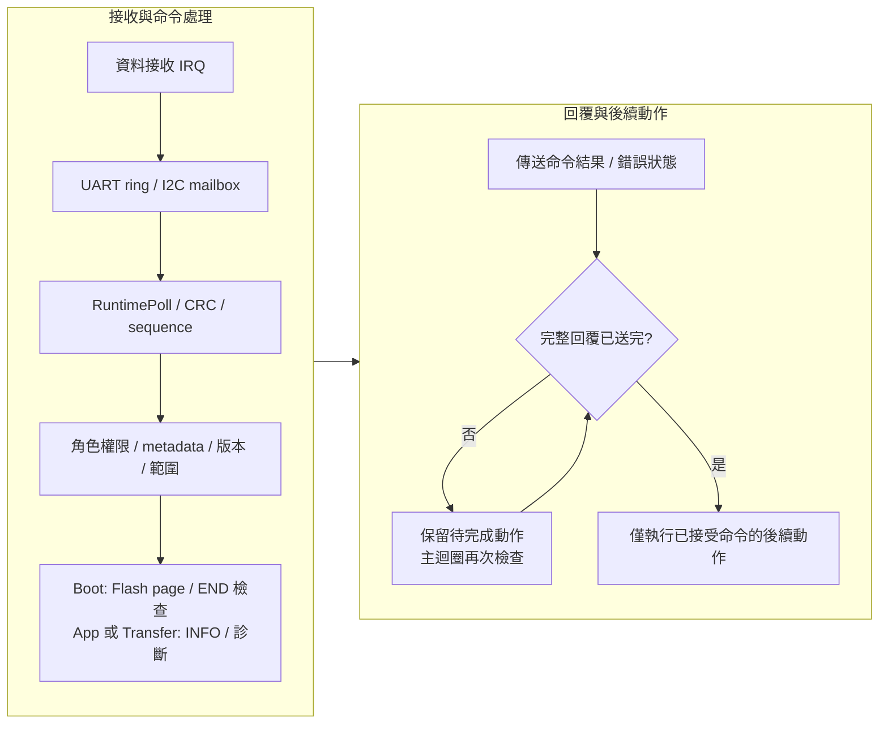
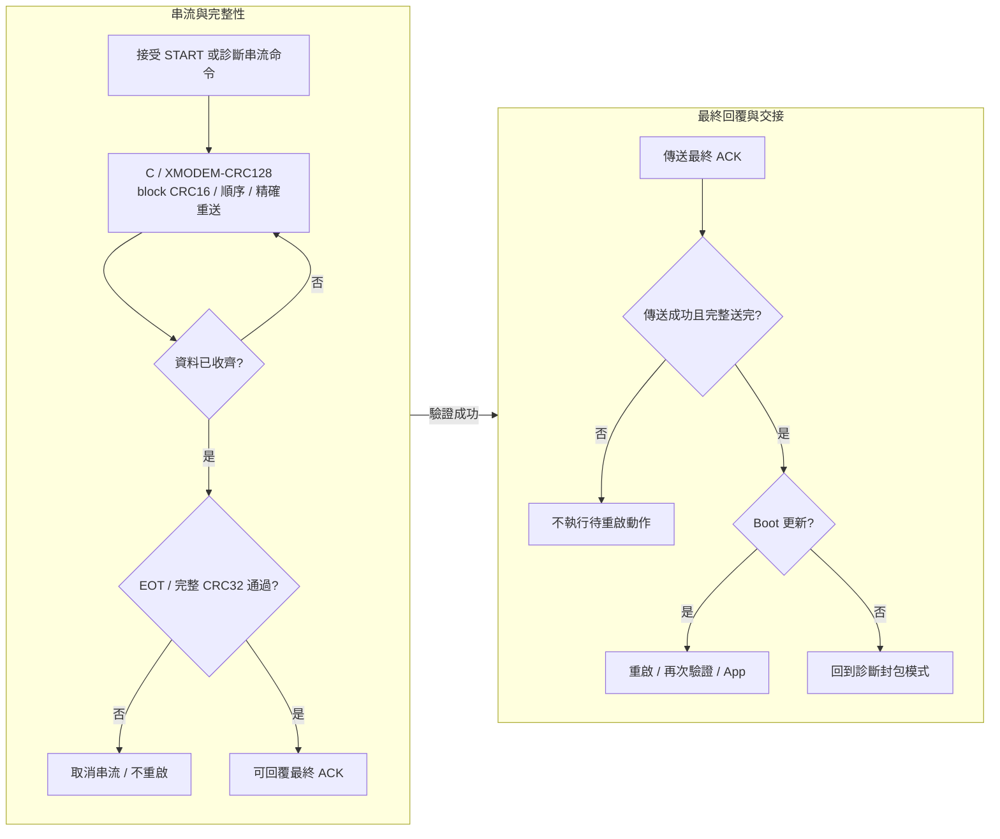

[知識庫首頁](https://released.github.io/) · [RH850 Bootloader](index.html)

<a id="article_top"></a>

# UART／Xmodem／I2C device 工程

獨立串列工程、資料／Log 介面與 IRQ／回覆完成邊界。

<!-- BOOTLOADER_TOPICS_BEGIN -->
## 本頁主題

| 章節／規格 | 本頁 | 另一平台 |
| --- | --- | --- |
| 配置與資料來源 | [閱讀](#guide-serial-device-1) | [RL78](../slide_boot_loader_for_RL78/serial-device.html#guide-serial-device-1) |
| 編輯、產生與建置 | [閱讀](#guide-serial-device-2) | [RL78](../slide_boot_loader_for_RL78/serial-device.html#guide-serial-device-2) |
| Metadata offset與協定配置 | [閱讀](#guide-serial-device-3) | [RL78](../slide_boot_loader_for_RL78/serial-device.html#guide-serial-device-3) |
| SC設定與重新產生 | [閱讀](#guide-serial-device-4) | [RL78](../slide_boot_loader_for_RL78/serial-device.html#guide-serial-device-4) |
| Framed control與INFO | [閱讀](#guide-serial-device-5) | [RL78](../slide_boot_loader_for_RL78/serial-device.html#guide-serial-device-5) |
| UART診斷格式 | [閱讀](#guide-serial-device-6) | [RL78](../slide_boot_loader_for_RL78/serial-device.html#guide-serial-device-6) |
| I2C mailbox | [閱讀](#guide-serial-device-7) | [RL78](../slide_boot_loader_for_RL78/serial-device.html#guide-serial-device-7) |
| XMODEM-CRC128資料與診斷 | [閱讀](#guide-serial-device-8) | [RL78](../slide_boot_loader_for_RL78/serial-device.html#guide-serial-device-8) |
| 驗證範圍 | [閱讀](#guide-serial-device-9) | [RL78](../slide_boot_loader_for_RL78/serial-device.html#guide-serial-device-9) |
<!-- BOOTLOADER_TOPICS_END -->

<!-- RH850_SERIAL_CHAPTER_BEGIN -->
## MCU 串列 ISP 工程配置

本章的UART／Xmodem／I2C各使用獨立Boot／App／Transfer工程，並保留獨立文字Log。
Flash、IRQ與RAM執行細節集中於 [移植與Flash](porting.html)。

#### RH850 文件入口

| 目的 | 說明位置 |
| --- | --- |
| Classical CAN／CAN FD、CAN port 與接收資源 | [CAN device 工程](can-device.html) |
| UART／Xmodem／I2C、獨立 Log 與串列主迴圈 | 本文件 |
| Tool 操作、完成提示與更新報告 | [串列操作](https://released.github.io/slide_simple_renesas_isp_tool/serial-isp.html)、[共用操作](../slide_simple_renesas_isp_tool/operation.html) |
| 格式欄位與通訊封包 | [串列工程配置](#guide-serial-device-3)；實際地址與 IRQ 使用本文件配置 |

各介面都有獨立 Boot／App／Transfer 工程。
共用格式與操作透過上方連結查閱，平台地址、腳位與中斷配置集中在各自工程章節。

<a id="guide-serial-device-1"></a>

### 配置與資料來源

#### 專案與目錄

下列 Boot／App／Transfer 各自包含來源碼、設定與建置工具，可獨立編譯。
每個介面使用自己的工程與映像契約；搭配安裝的 Boot／App 保持相容設定。
目錄與使用者入口見 [工程目錄與程式入口](porting.html#rh850-project-entry)。

| 介面 | Boot | App | Custom Transfer |
| --- | --- | --- | --- |
| UART ISP | Sample_Project_RH850_S1_ISP_Boot_loader_UART | Boot 名稱加 `_app` | Sample_Project_RH850_S1_UART_Transfer |
| XMODEM-CRC128 | Sample_Project_RH850_S1_ISP_Boot_loader_Xmodem | Boot 名稱加 `_app` | Sample_Project_RH850_S1_Xmodem_Transfer |
| I2C ISP | Sample_Project_RH850_S1_ISP_Boot_loader_I2C | Boot 名稱加 `_app` | Sample_Project_RH850_S1_I2C_Slave_Transfer |

Transfer 是以燒錄器安裝的獨立診斷程式，不是 App 更新 BIN。
診斷路徑不擦寫 Flash；Xmodem Transfer 使用 command24 接收串流並核對 CRC32。

#### 接線與時脈

| 用途 | MCU 周邊／腳位 | 設定 | EIINT channel |
| --- | --- | --- | --- |
| UART／Xmodem 資料 | RLIN31 TX P0_5、RX P0_4 | 115200、8-N-1 | RX122、Error123 |
| I2C 資料 | RIIC1 SCL P8_1、SDA P8_0 | 7-bit address0x20、100kHz | TX240、Event241、RX242；TEI243 保持遮罩 |
| 獨立文字 Log | RLIN30 TX P10_10、RX P10_9 | 115200、8-N-1；接收 IRQ 遮罩 | 不使用資料介面接收 |
| 系統 tick | OSTM0 | 1ms | 84 |
| 系統時脈 | 外部16MHz／PLL | CPU120MHz | App 檢查 Boot 交接時脈 |

UART 與 I2C 腳位依選定 SDK 範例的初始化程式配置。
連到 bridge 前仍需核對 EVM 接頭、電壓、共地與 I2C 上拉。
診斷 UART 不接到二進位 ISP 資料鏈路。

文字 Log 使用專案內 `retarget.c`／`retarget.h` 的 `tiny_printf()`，由 `SendChar()` 輸出至 UART0。
格式與使用位置見 [App 執行標記與 counter](app-development.html#rh850-runtime-log)。

UART建置以 `validate_serial_settings.ps1` 比對INFO／metadata baud與該工程SC產生的採樣、prescaler及LBRP。
執行時另核對實際UART暫存器計算的baud誤差，EVM的RLIN source為40MHz。
變更速率時同步調整配對Boot／App的SC與 `isp_transport_config.h`；不變更獨立文字Log設定。

<a id="guide-serial-device-2"></a>

### 編輯、產生與建置

#### 建置與檔案使用

在任一工程目錄以 PowerShell 執行：

```powershell
.\build.ps1
```

預設只建置該工程。
在所選工程根目錄執行 `build.ps1`，只建置該工程並執行本機 pre/post-build 檢查。
使用已安裝的 CS+／CC-RH 與 PowerShell，不需額外的 Python 或 JSON 編輯環境。

工程保留所選 UART／RIIC 的 Smart Configurator component；建置使用受控的 clock、system／IRQ projection。
重新產生 SC 原始碼後，核對獨立 Log、資料腳位與時脈設定，再執行同一份建置檢查。

#### 建置訊息

| 訊息 | 來源與處理 |
| --- | --- |
| `W0520550` 未使用狀態 | 角色專用變數依 Boot／App／Transfer 分開宣告；目前九工程不再出現這類警告 |
| `W0561322` `.text` alignment mismatch | 專案輸入採4-byte 對齊，原廠預編譯 C library 採2-byte。最終 `.text` 仍以4-byte 連結；保留診斷，未修改 library 或關閉警告 |
| `W0561017` CC-RH 授權 | 由目前編譯環境的授權狀態產生；依正式 CC-RH 授權配置處理。不是 firmware 功能警告，也不表示零警告建置 |

| 產物 | 用途 |
| --- | --- |
| Boot DefaultBuild/boot0000_FFFF.hex | 燒錄器安裝 Boot |
| App DefaultBuild/專案名稱_update.bin | Tool 對 device 更新 App |
| App DefaultBuild/app_build_report.html | 實際 BIN、CRC、metadata／IRQ 的建置結果 |
| Transfer DefaultBuild/專案名稱.hex | 燒錄器安裝獨立 Transfer 測試程式 |

Tool 使用 UART／Xmodem 或 I2C 的對應 Workflow。
操作步驟及訊息說明見[串列 ISP 操作](https://released.github.io/slide_simple_renesas_isp_tool/serial-isp.html)，欄位定義見[串列工程配置](#guide-serial-device-3)。
本頁的MCU、地址、EIINT與腳位表作為RH850工程配置來源。

<a id="guide-serial-device-3"></a>

### Metadata offset與協定配置

位址以App起點10000h、Metadata起點10100h計算；欄位offset的基準為Metadata，不是BIN起點。
CAN與串列工程分別使用其介面契約；此表為串列ISP。

| Offset | Bytes | 此RH850串列工程的內容／來源 |
| --- | --- | --- |
| 00 | 4 | ISP加NUL，49 53 50 00 |
| 04..07 | 4 | format6、core128、工程flags |
| 08..0B | 4 | UART protocol55h、I2C49h、Xmodem58h；版本／checksum宣告 |
| 0C | 2 | target8501h；另有介面配置bytes |
| 10／14／18 | 各4 | App version／build／實際image_size |
| 1C／20／24／28／2C | 各4 | App10000h／capacityF0000h／Flash100000h／Boot10000h／erase8000h |
| 30／34／38／3C | 各4 | I2C編譯Hz／7-bit address／0／0；UART、Xmodem為0 |
| 40..4F／50..5B | 16／12 | part與family ASCII、NUL padding |
| 5C | 4 | 最小格式長度，實際向量／code範圍另由映像驗證器檢查 |
| 60..67 | 8 | UPD1、policy3、32bytes、DEVICE_APP；UART／Xmodem允許UART04，I2C允許02 |
| 68／6C | 各4 | R8V1 IRQ ABI31563852h／最低Boot版本 |
| 70／74 | 各4 | UART／Xmodem編譯baud（I2C為0）／version control |
| 78..7F／80..FF | 8／128 | zero／FF |

編輯位置為`app_image_config.h`、`image_metadata_config.h`及`isp_transport_config.h`；size與CRC由post-build產生。
例如version control位於Flash10174h；其餘位址依本表offset加10100h換算。


<a id="guide-serial-device-4"></a>

### SC設定與重新產生

<a id="rh850-serial-sc-roundtrip"></a>

#### Smart Configurator 重新產生與建置

1. 保存工程設定及 App 的兩份 C header；由本工程 `.scfg` 開啟 Smart Configurator。
2. 核對 device 為 R7F701684、外部晶振16MHz。資料介面選用 Config_UART1 或 Config_RIIC1，另保留 Config_UART0、Config_OSTM0 與 Config_TAUJ0_0。
3. 執行 Generate Code，保存 SC 產生結果。既有 user-code 區保留對應 callback；資料 ISP adapter 不置於產生檔中。
4. 在該工程執行 `build.ps1`，或在已設定 hooks 的 CS+ 工程執行 Rebuild。建置會由最新 SC 來源產生受控 clock、timer／system 與完整 IRQ table，不自動重設使用者 `.scfg`。
5. 核對建置後檢查成功；App 另開啟 `app_build_report.html`，確認 metadata、CRC、512項 IRQ 與實際 BIN。App-only 變更不重建 Boot。
6. 上板時確認資料傳輸、診斷 Log、tick、中斷及重啟；離線建置通過不代表這些硬體動作已驗證。

| 可編輯來源 | 建置衍生結果 | 核對重點 |
| --- | --- | --- |
| `.scfg`／SC user-code 區 | `src/smc_gen` | 選定周邊與 pin 設定 |
| SC clock／system／timer 來源 | `generated_projection` 的受控 C 檔 | Boot 時脈設定、App 繼承檢查、timer ISR 無重複 channel 所有權 |
| `app_irq_handlers.h` | 完整512-entry IRQ table | 使用 EIINT channel；編譯後目的地與 C header 相符 |
| `app_image_config.h`／共用工程契約 | identity、metadata、更新 BIN、HTML | 編輯值與實際連結映像一致 |

<!-- RH850_SERIAL_WIRE_BEGIN -->
<a id="guide-serial-device-5"></a>

### Framed control與INFO

| Frame byte | Bytes | 意義 |
| --- | --- | --- |
| 0..1 | 2 | 49 53 marker |
| 2／3 | 各1 | framing version1／request0或response1 |
| 4..5 | 2 | sequence LE16，1..65535 |
| 6／7 | 各1 | command／status，request status0 |
| 8..9 | 2 | payload長度LE16，0..96 |
| 10.. | 0..96 | payload |
| payload之後 | 4 | header與payload的CRC32，LE32 |

CRC32/ISO-HDLC：reflected polynomial EDB88320，initial／final XOR FFFFFFFF；123456789=CBF43926。
Frame最長110bytes；UART partial frame200ms逾時。相同sequence僅允許完全相同request重播。

| Command | 作用 |
| --- | --- |
| 01 INFO | 88-byte live contract／mode／MCU／geometry／installed App／capabilities |
| 02 ENTER | 回覆完成後reset到Boot；Boot直接ACK |
| 03 METADATA | LE16 offset加4..64bytes，依序stage256，不擦Flash |
| 04 START／0E FORCE_START | LE32完整size加LE32末端CRC；先驗證metadata與policy |
| 05 WRITE／06 END | UART／I2C：ordered64-byte write與完整映像驗證；Xmodem Boot拒絕，改由raw block／EOT處理 |
| 07 ABORT | 清session／staging，不復原已擦寫內容 |
| 08 READ_METADATA／09 VERIFY | 有效App metadata讀回／Boot唯讀重算完整映像 |
| 20 PING／21 ECHO | App／Transfer回傳0..96bytes |
| 22 STATS／23 CLEAR_STATS | App／Transfer四個LE32：requests、replays、errors、written |
| 24 STREAM_TEST | Xmodem App／Transfer宣告size1..65536與CRC32，轉到RAM診斷sink |
| 25 DIAGNOSTICS | 宣告能力的UART／Xmodem App／Transfer，回覆唯讀24-byte UART快照 |

INFO bytes0..7依序為contract、mode、transport、max-write、LE16target、valid、active。
Bytes8..39為八個LE32：App start、capacity、Flash、Boot、erase、Boot version、Boot build、bus rate。
Bytes40..51為installed version／build／size；52..55為policy／ready／LE16capabilities。
Bytes56..71為part16，72..83為family12，84..87為IRQ ABI。
Boot能力0F、App3C、Transfer10；Transfer不回報installed App／Boot分區與IRQ ABI，其對應值為零。
提供UART診斷callback的App／Transfer另加能力bit6（0x40）；Boot不加此位元。

<a id="serial-uart-diagnostics"></a>

<a id="guide-serial-device-6"></a>

### UART診斷格式

Command0x25不帶payload。只有INFO宣告bit6時才查詢；回覆是下表24bytes，多byte整數採little-endian。
回覆使用相同sequence快取規則；重播同一request不重新讀取硬體。

| Offset | Bytes | 內容與範例 |
| --- | --- | --- |
| 00 | 1 | 格式1 |
| 01 | 1 | 診斷種類1：Device UART |
| 02..03 | 2 | 欄位mask0x000F，代表本表四組計數／queue欄位均提供 |
| 04..07 | 4 | RX硬體錯誤次數 |
| 08..0B | 4 | RX queue丟棄新資料次數 |
| 0C..0F | 4 | 本機TX timeout次數 |
| 10..13 | 4 | RX queue最高使用bytes |
| 14..17 | 4 | 快照當下RX queue待處理bytes |

RH850硬體錯誤／丟棄／TX計數飽和於0xFFFFFFFF，欄位序列化為32bits。
最高量與待處理量是bytes，不是CAN frame數；reset後重新起算，不宣告跨重啟的累積量。
快照只短暫保留並還原對應IRQ遮罩，不清空接收queue或重設周邊。
`CLEAR_STATS`只清除協定計數，不清除此硬體診斷快照的累積量。
Tool保留支援／未提供／讀取失敗的區別；畫面與報告的用途見[Device串列診斷](https://released.github.io/slide_simple_renesas_isp_tool/serial-isp.html#serial-device-diagnostics)。

<a id="guide-serial-device-7"></a>

### I2C mailbox

I2C先寫一個STOP-delimited request，最長110bytes，再讀固定111bytes。
Byte0為00 busy或A5 ready；ready後接完整framed reply，其餘FF。
Tool只寫入一次request，再以唯讀poll等候；不因busy重送Flash request。

RIIC ISR只處理有界Start／Receive／Next／NACK／STOP。
Main loop才解析／執行Flash並發布不可變reply；ENTER／END需等完整ready read、最終NACK及STOP後才reset。
Short read保留reply，mailbox有2秒lease；buffer overflow、busy時寫入及錯誤交易不授權更新。

<a id="guide-serial-device-8"></a>

### XMODEM-CRC128資料與診斷

| Byte／控制 | 意義 |
| --- | --- |
| 0 | SOH01 |
| 1／2 | 8-bit block number／ones complement，可wrap |
| 3..130 | 128-byte payload，末塊unused positions填1A |
| 131／132 | CRC16/XMODEM high／low byte，poly1021、init0 |
| C／ACK／NAK／CAN | 43／06／15／18；兩個CAN取消 |
| EOT04 | 完整映像或診斷CRC32 finalization，只送一次 |

Metadata與START仍使用framed ISP control。Receiver以宣告size排除1A padding，CRC16保護各block；CRC32保護完整useful data。
重送只允許相同block及完整相同128-byte內容；Tool最多三次相同block嘗試，不重送EOT。
Partial block200ms逾時NAK，idle10秒取消；完成／錯誤／取消後恢復framed parser。
本機無法送出C、ACK或NAK時，接收器取消串流並清除待重啟動作。
Boot只有完整映像驗證通過且最終ACK已由本機傳送完成後才reset；對端是否收到仍由Tool後續確認。

App／Transfer的0x24使用RAM CRC32 sink，沒有Flash erase／write／reset；Boot更新路徑才寫Flash並驗證映像。
Tool的389-byte診斷涵蓋短末塊，模型亦涵蓋65536-byte block-number wrap、CRC錯誤、duplicate、cancel及timeout。
<!-- RH850_SERIAL_WIRE_END -->

<a id="rh850-serial-runtime"></a>

#### UART／I2C 中斷與完成邊界

UART RX IRQ 只放入512-slot RAM ring（511bytes 可用），滿時丟棄新資料並計數。
Error IRQ 清除錯誤並計數；protocol、CRC、Flash 與 Log 都在 main loop。
TX 在主迴圈有界等待最後一個字元傳完後，才執行 ENTER／END 後續動作。

RIIC RX／TX／Event ISR 只移動 mailbox bytes 與狀態。
請求以 STOP 分界；回覆是111-byte read window，短讀保留回覆。
Event IRQ 的優先序高於 byte IRQ，STOP 與末筆 RX 同時待處理時先收下該筆資料。
NACK 保留到 STOP 後才清除，其間遮罩 NACK 中斷，不在 ISR 等待 STOP。
回覆完成判斷扣除仍在 DRT 的預載資料；無法證明完整 read 時不允許重啟。



ISR 不解析 ISP 命令、不呼叫 Flash，也不輸出 Log。
App 的 ready 回覆須已觀察到系統 tick；獨立 Transfer 不宣告已安裝 App 或 Flash 分區。
UART／Xmodem App與Transfer提供能力bit6／command0x25的接收錯誤、queue drop、TX timeout及queue快照；
完整byte欄位集中於[串列診斷格式](#serial-uart-diagnostics)，Tool判讀亦沿用該文件連結的操作章節。

#### Xmodem 串流完成

Boot 使用串流寫入及完整映像檢查；App／Transfer 的 command24 只接收資料並核對 CRC32。
128-byte block 的 CRC16、順序、重送與末塊填充由接收器核對。



最終 ACK 傳送失敗時不自動重啟，也不重複寫入來推定更新結果。
Tool 的 ACK 接收結果與 device 完整傳送是不同觀察點；線路中斷仍需由重連及映像狀態確認。

RIIC 暫存器與上述順序依 [RH850/F1KH、F1KM 硬體手冊](https://in.element14.com/wcsstore/ExtendedSitesCatalogAssetStore/cms/asset/pdf/common/renesas-automotive/rh850-users-manual.pdf) 第23章核對，特別是23.3.15、23.4、23.5.5。

<a id="guide-serial-device-9"></a>

### 驗證範圍

#### 離線檢查與實板範圍

`test_rh850_isp.ps1` 使用實際 App BIN、C 引擎／Flash page adapter／映像驗證器及 Tool client，核對完整960KiB、512-entry table、CRC／replay／失敗後不得 reset 等條件。
`test_rh850_isp_runtime.ps1` 直接編譯實際 `RuntimePoll`、角色設定與 Flash／串流 adapter，分別測試三介面的 Boot／App／Transfer。
測試包含分段／損壞封包、精確重送、ready、角色權限、最終回覆完成及傳送失敗；Xmodem 診斷另涵蓋短尾、block wrap、CRC16 重試、完整 CRC32、取消與 timeout。
`test_rh850_isp_hal.ps1` 使用實際 ISR adapter 與模擬暫存器，核對 queue／NACK／STOP／短讀；它不模擬電氣波形與硬體時序。

`test_rh850_scfg_roundtrip.ps1` 在隔離副本呼叫已安裝的 Smart Configurator 重新產生原始碼，再建置及核對映像／RAM／IRQ；不以手工複製來源取代 SC 產生動作。
完成後比較原工程來源與 App-only Boot 交付檔雜湊，將設定檢查、實際產生、連結結果及硬體結果分開記錄。

實板後續核對 UART、Xmodem、I2C 的 Discover、Transfer、Enter Boot、App 更新與重連。
另外確認 FCL RAM 執行、獨立 Log、IRQ 持續運作、中斷／斷電與復原行為。
<!-- RH850_SERIAL_CHAPTER_END -->

---

[上一主題：App Metadata、IRQ 與更新耗時](app-development.html) · [指南入口](index.html) · [下一主題：Boot／App 移植與 Flash](porting.html)
